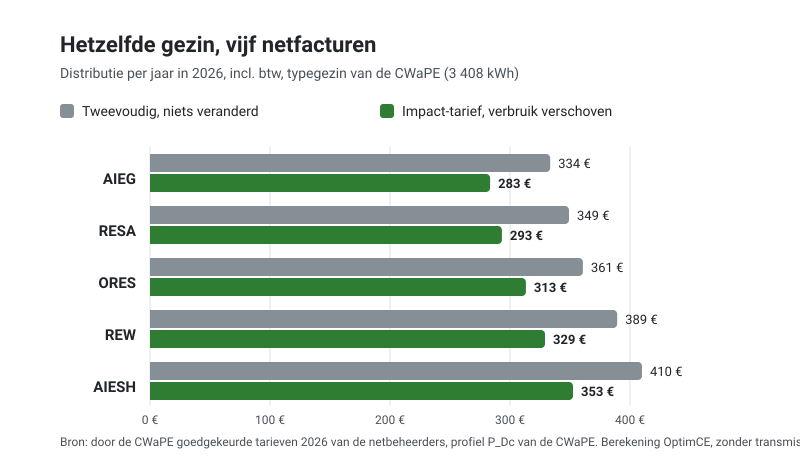

In 2026 hangt het distributienettarief voor elektriciteit in Wallonië af van iets wat u niet kiest: uw distributienetbeheerder. Voor 3 500 kWh per jaar met een enkelvoudige meter kost de distributie, btw inbegrepen, **400 €** bij AIEG, 414 € bij RESA, 433 € bij ORES, 463 € bij REW en **495 €** bij AIESH. Hetzelfde verbruik, dezelfde meter: 95 € verschil, bijna een kwart.

Deze gids rekent dat na op de referentieprofielen van de Waalse regulator CWaPE, met het tweevoudig tarief en het Impact-tarief, met en zonder elektrische auto of warmtepomp. Hij legt uit waar de verschillen vandaan komen en wat u kunt doen in plaats van van netbeheerder te veranderen, wat niet kan. Welke rij van de tabellen u betreft, staat in de [lijst van netbeheerders per gemeente](/nl/tools/wie-is-mijn-netbeheerder/gemeenten/), voor elk van de 261 Waalse gemeenten.

Hij herhaalt niet wat elders op deze site staat. Het gewicht van het net in de factuur en hoe het evolueert, staan in [“Waarom uw elektriciteitsfactuur hoog blijft”](/nl/gidsen/waarom-elektriciteitsfactuur-hoog-blijft-belgie/), tien manieren om de factuur te verlagen, berekend op het tarief van ORES, in [“Elektriciteitsfactuur verlagen: Wallonië 2026”](/nl/gidsen/elektriciteitsfactuur-verlagen-wallonie/), de keuze tussen sociaal tarief, tweevoudig tarief en dynamisch contract in [“Welk elektriciteitstarief kiezen in België?”](/nl/gidsen/elektriciteitstarief-kiezen-belgie/). De rol van de netbeheerder naast de leverancier heeft zijn eigen gids, [“Netbeheerder en leverancier: wie doet wat?”](/nl/gidsen/netbeheerder-leverancier-elia-wie-doet-wat/), net als het Impact-tarief: [“Impact-tarief en energiegemeenschap”](/nl/gidsen/impact-tarief-energiegemeenschap/).

**De beschreven regels en bedragen gelden alleen in Wallonië.** In Vlaanderen en Brussel is de netbeheerder Fluvius of Sibelga en gelden andere tarieven; het einde van de gids vat ze samen. De meeste documenten van de CWaPE en de Waalse netbeheerders bestaan alleen in het Frans.

## Wat het distributienettarief dekt, en wat niet

Het distributienettarief betaalt het distributienet, midden- en laagspanning, tot aan uw meter. Elke netbeheerder stelt het voor, de CWaPE keurt het goed, en uw leverancier rekent het ongewijzigd door. Het tariefblad van elke Waalse netbeheerder bestaat uit vier blokken:

- **het netgebruik**: een vast deel per jaar, van 14,10 € tot 26,50 € btw inbegrepen naargelang de netbeheerder, en een bedrag per kilowattuur dat afhangt van uw formule (enkelvoudig, tweevoudig, exclusief nacht of Impact-tarief);
- **de openbaredienstverplichtingen**, per kilowattuur aangerekend;
- **de toeslagen**: wegenisretributie, vennootschapsbelasting en andere lokale, provinciale of gewestelijke belastingen;
- **de regulatoire saldi**: de verschillen uit vorige jaren tussen begrote en werkelijke kosten en inkomsten, die de CWaPE controleert voor ze ze, naar boven of naar beneden, op de volgende tarieven overdraagt.

Het Impact-tarief heeft geen vast deel. Zijn component voor het vermogen staat in de vijf Waalse tariefbladen van 2026 op 0 €/kW: anders dan in Vlaanderen betaalt een Waals gezin dus geen capaciteitstarief. Exclusief nacht wordt bij de vijf netbeheerders aan de prijs van de daluren aangerekend.

**De transmissie zorgt voor geen enkel verschil.** De netbeheerder rekent ook de kosten van het transmissienet van Elia door, tegen hetzelfde tarief in heel Wallonië: 2,74252 c€/kWh btw inbegrepen in 2026, of 96 € voor 3 500 kWh. Die komt bovenop de bedragen in deze gids, die alleen over distributie gaan.

**Niet gedekt** zijn: de energie, waarvan de prijs van uw contract afhangt; de energiebijdrage en de bijzondere accijns, vastgelegd door de federale wet; de aansluitingsvergoeding, vastgelegd door het Waals Gewest. De btw van 6 % geldt voor het distributienettarief zoals voor de rest van de factuur, behalve voor de aansluitingsvergoeding.

## Methode: de profielen van de CWaPE en de goedgekeurde tarieven

Om de distributiekosten voor 2026 tot 2029 te simuleren, gebruikt de CWaPE referentieprofielen die het werkelijke, geanonimiseerde verbruik van Waalse gezinnen zijn. Ze publiceert ze met hun verdeling over de tijdsblokken, in een basisversie en in een versie waarin het gezin een deel van zijn verbruik verschuift. Wij nemen ze ongewijzigd over, naast het referentiegeval van onze andere gidsen.

| Profiel | Jaarverbruik | Tweevoudig, piek / dal (kWh) | Impact-tarief, ECO / MEDIUM / PIC (kWh) |
|---|---|---|---|
| Referentiegeval van de site | 3 500 kWh, enkelvoudig | — | — |
| P_Db, klein gezin | 2 077 kWh | — | 893 / 527 / 656 |
| P_Dc, typegezin | 3 408 kWh | 1 613 / 1 795; verschoven: 1 427 / 1 981 | 1 410 / 1 022 / 976; verschoven: 1 796 / 790 / 822 |
| P_DcVE1, elektrische auto | 7 380 kWh | 3 445 / 3 935; verschoven: 1 787 / 5 604 | 3 147 / 2 079 / 2 154; verschoven: 5 282 / 1 032 / 1 050 |
| P_DcPAC, warmtepomp | 7 502 kWh | 3 462 / 4 040; verschoven: 2 721 / 4 781 | 3 345 / 2 228 / 1 929; verschoven: 4 285 / 1 727 / 1 490 |

*Hypothesen: profielen uit bijlage 9 van beslissing CD-25f26-CWaPE-1119 van 26 juni 2025, kolommen 2026-2029. In de verschoven versie verplaatst het gezin vaatwasser, wasmachine en droogkast, en naargelang het profiel het laden van de auto (3,7 kW, ongeveer 22 000 km per jaar) of het voorverwarmen met de warmtepomp. De verschoven volumes van het profiel met elektrische auto komen samen op 7 391 kWh met het tweevoudig tarief en 7 364 kWh met het Impact-tarief, niet op 7 380 kWh: wij nemen ze over zoals gepubliceerd. Het geval van 3 500 kWh met een enkelvoudige meter is dat van onze andere gidsen.*

De tarieven zijn die van de laagspanningstarieven 2026 die de CWaPE voor elke netbeheerder heeft goedgekeurd. De kosten van een profiel zijn het vaste deel plus elk volume maal de prijs van zijn tijdsblok, met alle distributiecomponenten, en daarna 6 % btw. Zo nagerekend, komen de prijzen per kilowattuur tot op de vijfde decimaal overeen met het overzicht inclusief btw dat de CWaPE op 3 februari 2026 publiceerde. Bij AIEG staat op de regel “andere lokale, provinciale of gewestelijke belastingen” de letter “V” zonder bedrag: net als het overzicht van de CWaPE nemen wij die niet mee. De bedragen zijn afgerond op de euro.

Voor AIESH en RESA komen onze totalen exclusief btw voor het typegezin met tweevoudig tarief, 387 € en 329 €, overeen met de persmap van de CWaPE van 1 juli 2025. Voor ORES en AIEG liggen ze hoger: 340 € tegenover 325 €, 315 € tegenover 305 €. Die persmap steunde op wat in juni 2025 bekend was, en de CWaPE waarschuwde dat de tarieven nog konden veranderen, met name bij de toewijzing van de regulatoire saldi. Wij rekenen met de geldende tarieven, voor ORES het tarief dat op 18 december 2025 werd goedgekeurd.

### De gegevens downloaden

Het bestand [distribution-tariffs-wallonia-2026.csv](/assets/data/distribution-tariffs-wallonia-2026.csv) bevat de 90 combinaties van de berekening: één rij per netbeheerder, profiel, formule en variant, met de volumes per tijdsblok, het vaste deel, de distributie exclusief en inclusief btw, de transmissie, de totale netkosten en een link naar het gebruikte tariefblad. Kolomnamen en waarden zijn in het Engels. Het wordt gepubliceerd onder de licentie [CC BY 4.0](https://creativecommons.org/licenses/by/4.0/deed.nl): u mag het hergebruiken met vermelding van “OptimCE, op basis van de door de CWaPE goedgekeurde tarieven”. Het [rekenscript](https://github.com/OptimCE/website/blob/main/scripts/compare_distribution_tariffs.py) is openbaar: het bevat elk tarief met zijn bron en geeft geen resultaat als de tariefbladen het overzicht van de CWaPE niet meer opleveren.

## Resultaten: wat de distributie kost bij elke Waalse netbeheerder

### Met een enkelvoudige meter: 3 500 kWh

| Netbeheerder | Vast deel (€/jaar) | Distributie (c€/kWh) | Distributie per jaar | Verschil met de goedkoopste |
|---|---|---|---|---|
| AIEG | 19,50 | 10,87 | **400 €** | — |
| RESA | 26,50 | 11,06 | **414 €** | +14 € (+3 %) |
| ORES | 14,10 | 11,98 | **433 €** | +33 € (+8 %) |
| REW | 26,44 | 12,48 | **463 €** | +63 € (+16 %) |
| AIESH | 17,93 | 13,64 | **495 €** | +95 € (+24 %) |

*Hypothesen: door de CWaPE goedgekeurde tarieven 2026, bedragen inclusief btw; vast deel en prijs per kilowattuur uit het overzicht van de CWaPE van 3 februari 2026. Alleen distributie: de transmissie voegt bij de vijf netbeheerders 96 € toe. De netbeheerders staan van goedkoopste naar duurste, zoals in de volgende tabellen.*

Het vaste deel weegt nauwelijks: het verschil zit in de prijs per kilowattuur. RESA heeft het hoogste vaste deel en blijft toch de op een na goedkoopste.

### Het typegezin, met tweevoudig tarief en Impact-tarief

P_Dc is het profiel waarmee de CWaPE een residentieel gezin illustreert: 3 408 kWh per jaar, zonder elektrisch warm water.

| Netbeheerder | Enkelvoudige meter | Tweevoudig | Tweevoudig, verbruik verschoven | Impact-tarief | Impact, verbruik verschoven |
|---|---|---|---|---|---|
| AIEG | 390 € | 334 € | 323 € | 312 € | 283 € |
| RESA | 404 € | 349 € | 340 € | 321 € | 293 € |
| ORES | 422 € | 361 € | 350 € | 344 € | 313 € |
| REW | 452 € | 389 € | 378 € | 360 € | 329 € |
| AIESH | 483 € | 410 € | 397 € | 389 € | 353 € |

*Hypothesen: distributie per jaar, inclusief btw, tarieven 2026, profiel P_Dc van de CWaPE met zijn volumes per tijdsblok. De kolom “enkelvoudige meter” past de enkelvoudige prijs toe op alle 3 408 kWh. Het Impact-tarief heeft geen vast deel. Zonder transmissie, 93 € voor dit profiel bij de vijf netbeheerders.*

De rangschikking verandert van kolom tot kolom niet, en het verschil tussen AIEG en AIESH blijft bij alle berekende profielen tussen 23 en 25 %. Het kleine gezin P_Db (2 077 kWh, zonder mogelijkheid tot verschuiven) betaalt 245 € tot 301 € met een enkelvoudige meter, 191 € tot 239 € met het Impact-tarief.

### Met een elektrische auto of een warmtepomp

Als het verbruik verdubbelt, verdubbelt ook het verschil in euro.

| Netbeheerder | Elektrische auto, tweevoudig | Elektrische auto, Impact verschoven | Warmtepomp, tweevoudig | Warmtepomp, Impact verschoven |
|---|---|---|---|---|
| AIEG | 697 € | 500 € | 706 € | 590 € |
| RESA | 723 € | 526 € | 732 € | 612 € |
| ORES | 762 € | 555 € | 772 € | 652 € |
| REW | 809 € | 588 € | 820 € | 687 € |
| AIESH | 864 € | 617 € | 875 € | 732 € |

*Hypothesen: profielen P_DcVE1 (7 380 kWh, thuis laden) en P_DcPAC (7 502 kWh, lucht-waterwarmtepomp) van de CWaPE; kolommen “tweevoudig” zonder iets te veranderen, kolommen “Impact verschoven” met het door de CWaPE berekende verschoven verbruik. Distributie per jaar, inclusief btw, zonder transmissie.*

Voor de elektrische auto ligt er met het tweevoudig tarief 167 € tussen AIEG en AIESH. Maar een gezin bij AIESH dat overstapt naar het Impact-tarief en 's nachts laadt, betaalt 617 €, minder dan een gezin bij AIEG dat bij het tweevoudig tarief blijft en niets verandert (697 €).

### Prosumenten zonder digitale meter

Een prosument wiens meter de werkelijke afname niet registreert, betaalt een prosumententarief per kilowatt netto ontwikkelbaar vermogen van de installatie. Het volgt dezelfde volgorde.

| Netbeheerder | Prosumententarief (€/kWe, excl. btw) | Installatie van 4 kWp, per jaar (incl. btw) |
|---|---|---|
| AIEG | 76,45 | 324 € |
| RESA | 79,45 | 337 € |
| ORES | 80,98 | 343 € |
| REW | 87,74 | 372 € |
| AIESH | 93,67 | 397 € |

*Hypothesen: tarieven 2026, toegepast op het aan de netbeheerder opgegeven netto ontwikkelbaar vermogen; installatie van 4 kWp, het referentiegeval van onze zonnegidsen. Btw van 6 %.*

### Netkosten per gemeente: welke rij geldt voor u?

In Wallonië wordt elke gemeente door één enkele elektriciteitsnetbeheerder bediend; volgens de gegevens van onze tool is er geen enkele tussen twee netbeheerders verdeeld. Van de 261 Waalse gemeenten bedient ORES er 194 en RESA 54. AIEG bedient er zes (Andenne, Brunehaut, Gesves, Ohey, Rumes en Viroinval), AIESH ook zes (Beaumont, Chimay, Couvin, Froidchapelle, Momignies en Sivry-Rance), en REW één enkele, Waver. Uw gemeente staat in de [lijst van netbeheerders per gemeente](/nl/tools/wie-is-mijn-netbeheerder/gemeenten/), uw postcode in de tool [“Wie is mijn netbeheerder?”](/nl/tools/wie-is-mijn-netbeheerder/), die ook de Vlaamse en Brusselse gemeenten dekt.

## Vanwaar de verschillen

### Eén methode, vijf budgetten

De CWaPE legt de tariefmethodologie vast en keurt voor elke netbeheerder een toegelaten inkomen goed: het budget dat hij via zijn tarieven mag recupereren. De persmap van de CWaPE vat de regel samen: het niveau van de tarieven hangt af van het toegelaten inkomen enerzijds en van het verbruiksvolume waarover dat budget wordt verdeeld anderzijds, en daarna van hoe de netbeheerder het over de spanningsniveaus verdeelt. Voor de vijf netbeheerders samen bedraagt dat inkomen 945 miljoen euro in 2026. De tariefbladen tonen waar elke netbeheerder zich onderscheidt.

| Netbeheerder | Netgebruik | Openbaredienstverplichtingen | Toeslagen | Regulatoire saldi | Totaal |
|---|---|---|---|---|---|
| AIEG | 8,94 | 0,68 | 0,78 | 0,47 | **10,87** |
| RESA | 8,61 | 1,01 | 0,75 | 0,69 | **11,06** |
| ORES | 9,76 | 0,54 | 0,87 | 0,81 | **11,98** |
| REW | 9,86 | 1,17 | 1,34 | 0,11 | **12,48** |
| AIESH | 11,53 | 1,10 | 1,01 | 0,00 | **13,64** |

*Hypothesen: enkelvoudige prijs, c€/kWh inclusief btw, tarieven 2026. Toeslagen: wegenisretributie, vennootschapsbelasting en andere lokale, provinciale of gewestelijke belastingen.*

Drie patronen springen eruit:

- **AIESH** is het duurst door het net zelf: 11,53 c€ voor het netgebruik, tegenover 8,61 tot 9,86 c€ elders, terwijl ze in 2026 geen regulatoir saldo moet recupereren;
- **REW** heeft een prijs voor het netgebruik dicht bij die van ORES, maar de hoogste openbaredienstverplichtingen en toeslagen van de vijf, met de vennootschapsbelasting voorop;
- **ORES en RESA** dragen de zwaarste regulatoire saldi: 0,81 en 0,69 c€/kWh. De persmap van de CWaPE raamt de toewijzing voor 2026 op 26,1 miljoen euro bij ORES, 13,7 miljoen bij RESA, 0,3 miljoen bij AIEG, 0,1 miljoen bij REW en niets bij AIESH.

### Een lang net voor weinig klanten

De regel van de CWaPE heeft een eenvoudig gevolg: een net dat lang te onderhouden is voor weinig verbruik, weegt zwaarder op elke kilowattuur. De gegevens van de CWaPE over bovengrondse lijnen tonen het verschil op het terrein.

| Netbeheerder | Bovengrondse laagspanningslijnen (km) | Bovengrondse middenspanningslijnen (km) | Bediende gemeenten |
|---|---|---|---|
| AIEG | 513 | 111 | 6 |
| RESA | 5 170 | 684 | 54 |
| ORES | 19 347 | 2 955 | 194 |
| REW | 160 | 0 | 1 |
| AIESH | 781 | 385 | 6 |

*Hypothesen: bovengrondse lijnen eind 2024, tabel 32 van het advies CD-25k27-CWaPE-0967 over de aanpassingsplannen 2026-2030; bediende gemeenten volgens de gegevens van de tool “Wie is mijn netbeheerder?”, versie 2026.10.0.*

Met elk zes gemeenten beheert AIESH, in het zuiden van Henegouwen en in Couvin, meer bovengrondse lijnen dan AIEG: 781 km tegenover 513 km in laagspanning, 385 km tegenover 111 km in middenspanning. REW, het net van één enkele stad, heeft geen bovengrondse middenspanningslijn meer en staat toch vierde op vijf. Het terrein verklaart dus niet alles; de opsplitsing hierboven toont waar zijn tarief vandaan komt.

### De investeringen van de komende jaren

De aanpassingsplannen van de netbeheerders, die de CWaPE in november 2025 onderzocht, kondigen verschillende trajecten aan. ORES wil zijn jaarlijkse investeringen optrekken van 141 € per EAN-code over 2019-2023 tot 378 € over 2026-2030; REW, dat vroeger meer per klant investeerde dan het gemiddelde, plant voor 2026-2030 minder. Die investeringen gaan naar het toegelaten inkomen, en dus naar de tarieven van de volgende jaren.

### Geen tariefzones binnen een Waalse netbeheerder

Elke Waalse netbeheerder publiceert één tariefblad voor zijn hele gebied. ORES past dezelfde tarieven toe in zijn 194 gemeenten, RESA in zijn 54. In Wallonië betalen twee buren hetzelfde distributienettarief zodra ze van dezelfde netbeheerder afhangen; het verschil verschijnt pas op de grens tussen twee netbeheerders. In Vlaanderen hangt het tarief wel af van het netgebied van Fluvius.

## Kunt u eraan ontsnappen? Nee: wat u in de plaats kunt doen

In Wallonië wijst de regering de netbeheerder aan op voorstel van de gemeente en na advies van de CWaPE, voor ten hoogste twintig jaar, en een gemeente mag voor elektriciteit maar één netbeheerder voorstellen (Waals elektriciteitsdecreet, artikel 10). Van leverancier veranderen verandert niets aan het net. Uw netbeheerder verandert alleen als u verhuist of als uw gemeente van netbeheerder wisselt, zoals Couvin, dat in 2024 van ORES naar AIESH overging.

Wat in uw handen blijft:

- **Uw formule kiezen.** Voor het typegezin levert de overstap van het tweevoudig tarief naar het Impact-tarief, met verschoven was en vaat, 48 € (ORES) tot 60 € (REW) per jaar op; met een elektrische auto die thuis laadt, 196 € tot 246 €, meer dan de 167 € die dan de goedkoopste van de duurste netbeheerder scheiden. De voorwaarden van het Impact-tarief, waaronder de digitale meter, staan in onze [gids over het Impact-tarief](/nl/gidsen/impact-tarief-energiegemeenschap/), de andere formules in [“Welk elektriciteitstarief kiezen in België?”](/nl/gidsen/elektriciteitstarief-kiezen-belgie/).
- **Het forfaitaire prosumententarief verlaten**, als u produceert en nog van de compensatie geniet: met een meter die uw werkelijke afname registreert, betaalt u het net op die afname, en de tariefbladen begrenzen dat bedrag tot dat van uw netto-afname plus het prosumententarief. De details staan in [“Digitale meter in Wallonië: de gids”](/nl/gidsen/digitale-meter-wallonie/).
- **Nagaan of u recht hebt op het sociaal tarief.** Voor beschermde klanten legt de federale regulator CREG één netcomponent vast voor heel België: 11,727 c€/kWh btw inbegrepen in het vierde kwartaal van 2026, transmissie inbegrepen, ongeacht de netbeheerder of het gewest.
- **Minder verbruiken op de dure uren.** Elke vermeden kilowattuur bespaart u, naast de energie, de netprijs van zijn tijdsblok: 10,87 tot 13,64 c€ btw inbegrepen met een enkelvoudige meter, plus 2,74 c€ transmissie.

## Wat het betekent voor energiedelen

De CWaPE is duidelijk: alle netkosten, transmissie en distributie, zijn verschuldigd op gedeelde elektriciteit, en *“voor het delen binnen een energiegemeenschap bestaat er geen tariefkorting”* (onze vertaling). Een lid van een Waalse gemeenschap betaalt dus op elke gedeelde kilowattuur het tarief van zijn netbeheerder in zijn formule. De winst van het delen zit in de energieprijs, niet in het net.

Ook hier telt de formule. Met het Impact-tarief betaalt een kilowattuur die tussen 11 en 17 uur wordt verbruikt, wanneer de zonnepanelen van een gemeenschap produceren, 7,30 c€ (AIEG) tot 8,26 c€ (REW) aan net, transmissie inbegrepen; met een enkelvoudige meter 13,61 c€ tot 16,38 c€.

De enige korting geldt voor delen binnen hetzelfde gebouw: de tarieven 2026 trekken daar 80 % van de proportionele termen van distributie en transmissie af op de gedeelde energie. Ze is meer waard waar het net meer kost.

| Netbeheerder | Netkosten van een kWh in de ECO-uren (distributie + transmissie) | Korting per kWh, enkelvoudig | Korting per kWh, ECO-uren | Op 500 kWh gedeeld (enkelvoudig) |
|---|---|---|---|---|
| AIEG | 7,30 | 9,22 | 4,17 | 46 € |
| RESA | 7,73 | 8,95 | 4,09 | 45 € |
| ORES | 7,83 | 9,88 | 4,37 | 49 € |
| REW | 8,26 | 9,96 | 4,39 | 50 € |
| AIESH | 8,24 | 11,29 | 4,78 | 56 € |

*Hypothesen: c€/kWh inclusief btw, tarieven 2026. De korting van 80 % geldt voor de proportionele term van het netgebruik in de distributie en voor die van de transmissie, niet voor openbaredienstverplichtingen, toeslagen of saldi. 500 kWh gedeeld per jaar: het referentiegeval van onze gidsen over delen.*

Hoe u verder gaat, beschrijft onze gids [“Toetreden tot een energiegemeenschap in Wallonië”](/nl/gidsen/energiegemeenschap-aansluiten-wallonie/).

## Wat er verandert op 1 januari 2027

De tariefbladen 2027 van AIEG, AIESH, RESA en REW staan op de website van de CWaPE. Voor het typegezin met tweevoudig tarief stijgt de distributie van 334 € naar 340 € bij AIEG (+2 %), van 349 € naar 359 € bij RESA (+3 %), van 389 € naar 394 € bij REW (+1 %) en van 410 € naar 429 € bij AIESH (+5 %), btw inbegrepen.

Het tariefblad 2027 van ORES gaat veranderen. Op 15 oktober 2026 keurde de CWaPE de aanvraag van ORES goed om zijn toegelaten inkomen voor 2026 tot 2029 te herzien (beslissing CD-26i15-CWaPE-1318): voor elektriciteit in 2027 gaat het om 49,9 miljoen euro, 7,45 % van het in 2025 goedgekeurde inkomen. ORES moest op 5 november 2026 op die basis een aangepast tariefvoorstel indienen; op 17 november 2026 staat er op de website van de CWaPE nog geen nieuw tariefblad. Ook het transmissietarief 2027 is nog niet gepubliceerd, en de regulatoire saldi kunnen nog alle bedragen doen bewegen. Wij rekenen opnieuw zodra de tarieven 2027 volledig zijn.

## Brussel en Vlaanderen

**In Brussel** is Sibelga de enige netbeheerder voor de negentien gemeenten, met één tariefblad dat de regulator Brugel goedkeurt; zijn tarieven 2026 werden aangepast bij beslissing 370 van 18 november 2025. Van de ene Brusselse gemeente tot de andere is er dus geen verschil in distributie.

**In Vlaanderen** beheert Fluvius het net, maar de Vlaamse Nutsregulator keurt de tarieven goed per netgebied, en de factuur bevat een capaciteitstarief op basis van uw piekvermogen. Voor een gemiddeld gezin van 3 500 kWh met een gemiddelde maandpiek van 4,26 kW berekent de regulator dat een gezin in het duurste netgebied in 2026 19 % meer betaalt voor elektriciteit dan in het goedkoopste, tegenover 23 % in 2025. Het Vlaamse verschil zit dus tussen netgebieden van dezelfde netbeheerder, het Waalse tussen vijf netbeheerders. De structuren verschillen te veel om euro per euro met Wallonië te vergelijken.

## Wat u moet onthouden

1. **Bij hetzelfde verbruik kost de distributie in Wallonië tot een kwart meer naargelang de netbeheerder.** Voor 3 500 kWh met een enkelvoudige meter: 400 € bij AIEG, 414 € bij RESA, 433 € bij ORES, 463 € bij REW en 495 € bij AIESH, btw inbegrepen.
2. **De rangschikking is voor elk profiel dezelfde.** Klein gezin, typegezin, elektrische auto of warmtepomp: het verschil tussen AIEG en AIESH blijft 23 tot 25 %.
3. **Transmissie en tijdsblokken zijn overal in Wallonië gelijk.** Alleen de prijzen van de tariefbladen verschillen, en binnen een Waalse netbeheerder zijn er geen tariefzones, anders dan de netgebieden in Vlaanderen.
4. **Het verschil komt van het budget van elke netbeheerder en wat hij per kilowattuur verdeelt**: een duurder landelijk net bij AIESH, zwaardere openbaredienstverplichtingen en toeslagen bij REW, saldi uit het verleden bij ORES en RESA.
5. **Uw netbeheerder kiest u niet, uw formule wel.** Met een elektrische auto levert een goed gebruikt Impact-tarief meer op dan het verschil tussen de goedkoopste en de duurste netbeheerder.
6. **Gedeelde energie betaalt het net zoals elke kilowattuur**, behalve binnen hetzelfde gebouw; met het Impact-tarief betaalt een kilowattuur die tussen 11 en 17 uur wordt verbruikt bijna de helft minder net dan met een enkelvoudige meter.

> ### Welk tarief geldt bij u?
>
> Elke Waalse gemeente wordt door één elektriciteitsnetbeheerder bediend. De gratis lijst van OptimCE geeft de netbeheerder van alle 565 Belgische gemeenten, voor elektriciteit en gas, met de bronnen.
>
> **[Netbeheerder van mijn gemeente bekijken →](/nl/tools/wie-is-mijn-netbeheerder/gemeenten/)**

## FAQ

### Waarom is elektriciteit in mijn Waalse gemeente duurder?

Omdat uw gemeente van één netbeheerder afhangt, en elk van de vijf eigen tarieven heeft. Voor 3 500 kWh met een enkelvoudige meter loopt de distributie in 2026 van 400 € bij AIEG tot 495 € bij AIESH. De energie hangt af van uw contract, de transmissie is overal gelijk. De [lijst per gemeente](/nl/tools/wie-is-mijn-netbeheerder/gemeenten/) vertelt u welke netbeheerder u bedient.

### Welke netbeheerder heeft het goedkoopste distributienettarief in Wallonië?

AIEG, dan RESA, ORES, REW en AIESH, ongeacht het profiel. Voor het typegezin van de CWaPE met tweevoudig tarief: 334 € bij AIEG, 410 € bij AIESH, btw inbegrepen. Kiezen kunt u niet: de netbeheerder is voor uw gemeente aangewezen.

### Hoe weet ik welk distributienettarief bij mij geldt?

U hebt uw netbeheerder en uw meterformule nodig. Onze lijst per gemeente geeft de netbeheerder van de 261 Waalse gemeenten, en elke Waalse netbeheerder past één tariefblad toe op zijn hele gebied. In Vlaanderen telt het netgebied, in Brussel geldt één tarief.

### Kan ik van netbeheerder veranderen om minder te betalen?

Nee: de gemeente stelt één netbeheerder voor, aangewezen voor ten hoogste twintig jaar, en van leverancier veranderen helpt niet. Uw hefboom is de formule: voor het typegezin levert een goed gebruikt Impact-tarief 48 tot 60 € per jaar op, 196 tot 246 € met een elektrische auto.

### Is het Impact-tarief goedkoper bij ORES, RESA of de andere netbeheerders?

De tijdsblokken zijn overal gelijk, de prijzen niet. In de ECO-uren, alle distributiecomponenten en btw inbegrepen: 4,56 c€ bij AIEG, 4,99 c€ bij RESA, 5,09 c€ bij ORES, 5,50 c€ bij AIESH en 5,52 c€ bij REW. Voor het typegezin dat zijn verbruik verschuift: 293 € bij RESA, 313 € bij ORES.

### Dalen de netkosten voor gedeelde elektriciteit in een Waalse energiegemeenschap?

Nee, behalve binnen hetzelfde gebouw, waar de tariefbladen 80 % van de proportionele termen aftrekken. In een gemeenschap betaalt de gedeelde kilowattuur het tarief van uw netbeheerder in uw formule; het Impact-tarief maakt ze goedkoper tussen 11 en 17 uur.

## Bronnen

- [CWaPE — Tarifs de distribution électricité applicables en Région wallonne du 1er janvier au 31 décembre 2026, TVAC](https://www.cwape.be/sites/default/files/cwape-documents/SYNTHESE%20DES%20TARIFS%20DE%20DISTRIBUTION%20ELEC%202026%20(FR)-m%C3%A0j%203.02.2026.pdf) (in het Frans) — overzicht bijgewerkt op 3 februari 2026: vast deel en prijs per kilowattuur inclusief btw van de vijf netbeheerders (enkelvoudig, tweevoudig, Impact, exclusief nacht), transmissie tegen 2,74252 c€/kWh, btw van 6 %, geen vast deel bij het Impact-tarief, federale en gewestelijke bevoegdheid voor de heffingen. Geraadpleegd op 17 november 2026.
- CWaPE — Periodieke afnametarieven laagspanning 2026 van [AIEG](https://www.cwape.be/sites/default/files/cwape-documents/AIEG%20-%20Tarifs%20p%C3%A9riodiques%20de%20pr%C3%A9l%C3%A8vement%202026_1.pdf), [AIESH](https://www.cwape.be/sites/default/files/cwape-documents/AIESH%20-%20Tarifs%20p%C3%A9riodiques%20de%20pr%C3%A9l%C3%A8vement%202026.pdf), [ORES](https://www.cwape.be/sites/default/files/cwape-documents/ORES%20-%20Tarifs%20p%C3%A9riodiques%20de%20pr%C3%A9l%C3%A8vement%202026_0.pdf) (goedgekeurd op 18 december 2025), [RESA](https://www.cwape.be/sites/default/files/cwape-documents/RESA%20-%20Tarifs%20p%C3%A9riodiques%20de%20pr%C3%A9l%C3%A8vement%202026.pdf) en [REW](https://www.cwape.be/sites/default/files/cwape-documents/REW%20-%20Tarifs%20p%C3%A9riodiques%20de%20pr%C3%A9l%C3%A8vement%202026.pdf) (in het Frans) — componenten exclusief btw (netgebruik, openbaredienstverplichtingen, toeslagen, regulatoire saldi), vast deel, prosumententarief, tijdsblokken van het tweevoudig tarief en het Impact-tarief, vermogenscomponent van 0 €/kW voor 2026-2029, exclusief nacht tegen de prijs van de daluren, korting van 80 % in hetzelfde gebouw, “V” van AIEG. Geraadpleegd op 17 november 2026.
- [CWaPE — Beslissing CD-26c26-CWaPE-1247 van 26 maart 2026](https://www.cwape.be/sites/default/files/cwape-documents/2026.03.26-1147-AIEG-%20D%C3%A9cision%20r%C3%A9vision%20TP%20distrib%20%C3%A9lec%202026%20suite%20rectification%20erreur%20mat%C3%A9rielle%20%2B%20annexe.pdf) (in het Frans) — herziening van het tariefblad 2026 van AIEG, beperkt tot de piektermen van klanten boven 56 kVA; de residentiële tarieven blijven ongewijzigd. Geraadpleegd op 17 november 2026.
- [CWaPE — Tarieven 2026 voor de doorrekening van de kosten van het transmissienet, alle Waalse netbeheerders](https://www.cwape.be/sites/default/files/cwape-documents/GRD%27s-Tarifs%20de%20refacturation%20du%20transport%202026.pdf) (in het Frans) — hetzelfde transmissietarief voor de vijf netbeheerders, korting van 80 % in hetzelfde gebouw. Geraadpleegd op 17 november 2026.
- [CWaPE — Toelichting bij de typeverbruiksprofielen voor de simulatie van de distributiekosten in laagspanning](https://www.cwape.be/sites/default/files/cwape-documents/2025.06.26-GRD%27s-%20Tarifs%20distrib.%20%C3%A9lec.%202026-2029-Annexe%209%20-%20Profils%20conso%20BT-annexe%20IX.pdf) (in het Frans) — bijlage 9 van beslissing CD-25f26-CWaPE-1119 van 26 juni 2025: profielen P_Db, P_Dc, P_DcVE1 en P_DcPAC, volumes per tijdsblok, basis- en verschoven versies. Geraadpleegd op 17 november 2026.
- [CWaPE — Persmap over de goedkeuring van de periodieke distributienettarieven elektriciteit 2026-2029](https://www.cwape.be/sites/default/files/cwape-documents/DP_tarifs%20distribution%202026-2029-final-corrig%C3%A9.pdf) (in het Frans) — 1 juli 2025: vorming van de tarieven (toegelaten inkomen en volumes), regulatoire saldi en hun toewijzing per netbeheerder, toegelaten inkomen van 945 miljoen euro in 2026, kosten van profiel P_Dc exclusief btw. Geraadpleegd op 17 november 2026.
- [CWaPE — Advies CD-25k27-CWaPE-0967 over de aanpassingsplannen 2026-2030 van de elektriciteitsnetbeheerders](https://www.cwape.be/sites/default/files/cwape-documents/CD-25k27-CWaPE-0967-Avis%20plans%20d'adaptation%20GRD%20%C3%A9lectricit%C3%A9%202026-2030.pdf) (in het Frans) — tabel 32 (bovengrondse lijnen per netbeheerder eind 2024), jaarlijkse investeringen per EAN-code, overgang van het net van Couvin van ORES naar AIESH in 2024. Geraadpleegd op 17 november 2026.
- [CWaPE — Beslissing CD-26i15-CWaPE-1318 van 15 oktober 2026 over de aanvraag van ORES Assets tot herziening van het toegelaten inkomen elektriciteit en gas 2026-2029](https://www.cwape.be/sites/default/files/cwape-documents/2026.10.15-1318-D%C3%A9cision%20sur%20revenus%20autoris%C3%A9s%20%C3%A9lectricit%C3%A9%20et%20gaz%202026-2029%20d'ORES%20-%20version%20anonymis%C3%A9e.pdf) (in het Frans) — tabel 29 (49,9 miljoen euro in 2027, 7,45 % van het op 3 april 2025 goedgekeurde inkomen elektriciteit), goedkeuring onder ontbindende voorwaarde en afdeling 7 (aangepast tariefvoorstel tegen 5 november 2026). Geraadpleegd op 17 november 2026.
- CWaPE — Periodieke afnametarieven laagspanning 2027 van [AIEG](https://www.cwape.be/sites/default/files/cwape-documents/AIEG%20-%20Tarifs%20p%C3%A9riodiques%20de%20pr%C3%A9l%C3%A8vement%202027_1.pdf), [AIESH](https://www.cwape.be/sites/default/files/cwape-documents/AIESH%20-%20Tarifs%20p%C3%A9riodiques%20de%20pr%C3%A9l%C3%A8vement%202027_0.pdf), [RESA](https://www.cwape.be/sites/default/files/cwape-documents/RESA%20-%20Tarifs%20p%C3%A9riodiques%20de%20pr%C3%A9l%C3%A8vement%202027_0.pdf) en [REW](https://www.cwape.be/sites/default/files/cwape-documents/REW%20-%20Tarifs%20p%C3%A9riodiques%20de%20pr%C3%A9l%C3%A8vement%202027.pdf) (in het Frans) — tariefbladen gepubliceerd op 17 november 2026. Geraadpleegd op 17 november 2026.
- [CWaPE — Faut-il payer les frais de réseau en cas de partage d'énergie ?](https://www.cwape.be/node/6062) (in het Frans) — bijgewerkt op 23 april 2026: netkosten verschuldigd op gedeelde elektriciteit, korting van 80 % alleen in hetzelfde gebouw, geen korting binnen een energiegemeenschap. Geraadpleegd op 17 november 2026.
- [CREG — Sociale tarieven elektriciteit, vierde kwartaal 2026](https://www.creg.be/sites/default/files/assets/Tarifs/Social/E-TSS-FR-2026-Q4.pdf) (in het Frans) — één netcomponent van 11,063 c€/kWh exclusief btw, 11,727 c€ inclusief, transmissie en distributie samengeteld. Geraadpleegd op 17 november 2026.
- [Wallex — Decreet van 12 april 2001 betreffende de organisatie van de gewestelijke elektriciteitsmarkt](https://wallex.wallonie.be/eli/loi-decret/2001/04/12/2001027238) (in het Frans) — artikel 10: aanwijzing van de netbeheerder door de regering op voorstel van de gemeente en na advies van de CWaPE, één elektriciteitsnetbeheerder per gemeente, termijn van ten hoogste twintig jaar. Geraadpleegd op 17 november 2026.
- [OptimCE — Netbeheerder per gemeente in België](/nl/tools/wie-is-mijn-netbeheerder/gemeenten/) — gegevens van de tool “Wie is mijn netbeheerder?”, versie 2026.10.0: 261 Waalse gemeenten, aantal gemeenten per netbeheerder, geen Waalse gemeente verdeeld over twee elektriciteitsnetbeheerders.
- [Brugel — Beslissing 370 van 18 november 2025 betreffende de aanpassing van de distributietarieven elektriciteit en gas van Sibelga voor 2026](https://brugel.brussels/publication/document/decisions/2025/fr/DECISION-370-ADAPTATIONS-TARIFAIRES-2026-SIBELGA.pdf) (in het Frans). Geraadpleegd op 17 november 2026.
- [Vlaamse Nutsregulator — Vlaamse Nutsregulator keurt de distributienettarieven voor 2026 goed](https://www.vlaamsenutsregulator.be/nieuws-en-persoverzicht/pers-2025-02) — persbericht bijgewerkt op 25 november 2025: verschil van 19 % tussen netgebieden in 2026 (23 % in 2025), gemiddeld gezin van 3 500 kWh met een gemiddelde maandpiek van 4,26 kW. Geraadpleegd op 17 november 2026.
