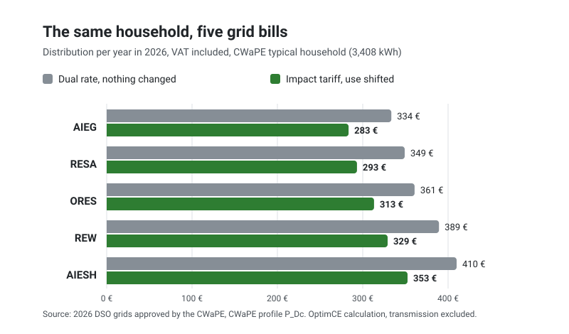

In 2026, the electricity distribution tariff in Wallonia depends on one thing you do not choose: your distribution system operator (DSO). For 3,500 kWh a year on a single-rate meter, distribution costs **400 €** including VAT with AIEG, 414 € with RESA, 433 € with ORES, 463 € with REW and **495 €** with AIESH. Same consumption, same meter: a 95 € gap, almost a quarter.

This guide redoes the calculation on the reference consumption profiles of the CWaPE, the Walloon energy regulator, on the dual rate and on the Impact tariff, with and without an electric car or a heat pump. It explains where the gaps come from, then what you can do instead of changing DSO, which is not possible. To see which row of the tables applies to you, the [DSO-by-municipality list](/en/tools/find-my-dso/municipalities/) gives the operator of each of the 261 Walloon municipalities.

It does not repeat what is written elsewhere on this site. The weight of the grid in the bill and how it is changing are in [“Why your electricity bill stays high in Belgium”](/en/guides/why-electricity-bill-still-high-belgium/); ten ways to cut the bill, costed on the ORES grid, in [“Reduce your electricity bill: Wallonia 2026”](/en/guides/reduce-electricity-bill-wallonia/); the choice between social tariff, dual rate and dynamic contract in [“Which electricity tariff to choose in Belgium?”](/en/guides/choose-electricity-tariff-belgium/). The DSO's role next to the supplier has its own guide, [“DSO vs supplier: who does what in Belgium?”](/en/guides/dso-vs-supplier-who-does-what-belgium/), and so does the Impact tariff: [“Impact tariff and energy communities”](/en/guides/impact-tariff-energy-community/).

**The rules and amounts described are Walloon.** Brussels and Flanders are summarised at the end. Most regulator and DSO documents exist in French only.

## What the distribution tariff covers, and what it does not

The distribution tariff pays for the distribution grid, medium and low voltage, up to your meter. Each DSO proposes it, the CWaPE approves it, and your supplier passes it on to you unchanged. Each operator's grid has four blocks:

- **network use**: a fixed part per year, from 14.10 € to 26.50 € including VAT depending on the DSO, and an amount per kilowatt-hour that depends on your formula (single rate, dual rate, exclusive night or Impact tariff);
- **public service obligations**, charged per kilowatt-hour;
- **surcharges**: a road-use levy, corporate income tax and other local, provincial or regional taxes;
- **regulatory balances**: the gaps of past years between budgeted and actual costs and revenue, which the CWaPE checks before carrying them over, up or down, into later tariffs.

The Impact tariff has no fixed part. Its power-related component is set at 0 €/kW in all five 2026 grids. Exclusive night is billed at the off-peak price by all five operators.

**Transmission creates no gap.** The DSO also passes on the cost of Elia's transmission grid, at the same tariff across Wallonia: 2.74252 c€/kWh including VAT in 2026, or 96 € for 3,500 kWh. It comes on top of the amounts in this guide, which cover distribution alone.

**Not covered**: energy, whose price depends on your contract; the energy contribution and the special excise duty, set by federal law; the connection fee, set by the Walloon Region. VAT at 6% applies to the distribution tariff as to the rest of the bill, except for the connection fee.

## Method: the CWaPE's profiles and the approved grids

To simulate distribution costs for 2026 to 2029, the CWaPE uses reference consumption profiles that are the real, anonymised consumption of Walloon households. It publishes them with their split between time bands, in a base version and a version where the household shifts part of its use. We use them as published, next to the reference case of our other guides.

| Profile | Annual use | Dual rate, peak / off-peak (kWh) | Impact tariff, ECO / MEDIUM / PIC (kWh) |
|---|---|---|---|
| Site reference case | 3,500 kWh, single rate | — | — |
| P_Db, small household | 2,077 kWh | — | 893 / 527 / 656 |
| P_Dc, typical household | 3,408 kWh | 1,613 / 1,795; shifted: 1,427 / 1,981 | 1,410 / 1,022 / 976; shifted: 1,796 / 790 / 822 |
| P_DcVE1, electric car | 7,380 kWh | 3,445 / 3,935; shifted: 1,787 / 5,604 | 3,147 / 2,079 / 2,154; shifted: 5,282 / 1,032 / 1,050 |
| P_DcPAC, heat pump | 7,502 kWh | 3,462 / 4,040; shifted: 2,721 / 4,781 | 3,345 / 2,228 / 1,929; shifted: 4,285 / 1,727 / 1,490 |

*Assumptions: profiles from annex 9 of decision CD-25f26-CWaPE-1119 of 26 June 2025, 2026-2029 columns. In the shifted version, the household moves its dishwasher, washing machine and dryer, plus, depending on the profile, the car's charging (3.7 kW, about 22,000 km a year) or the heat pump's pre-heating. The shifted volumes of the electric-car profile add up to 7,391 kWh on the dual rate and 7,364 kWh on the Impact tariff, not 7,380 kWh: we use them as published. The 3,500 kWh single-rate case is the one used in our other guides.*

The tariffs are those of the 2026 low-voltage grids approved by the CWaPE for each DSO. A profile's cost is the fixed part plus each volume times the price of its band, with every distribution component, then 6% VAT. Recalculated this way, the per-kWh prices match the VAT-inclusive summary the CWaPE published on 3 February 2026 to the fifth decimal. For AIEG, the line “other local, provincial or regional taxes” shows the letter “V” and no amount: like the CWaPE summary, we leave it out. Amounts are rounded to the euro.

For AIESH and RESA, our totals excluding VAT for the typical household on the dual rate, 387 € and 329 €, are those of the CWaPE press kit of 1 July 2025. For ORES and AIEG they are higher: 340 € against 325 €, 315 € against 305 €. That press kit was based on information known in June 2025, and the CWaPE warned that tariffs could still change, in particular when regulatory balances were allocated. We calculate on the grids in force, ORES's approved on 18 December 2025.

### Download the data

The file [distribution-tariffs-wallonia-2026.csv](/assets/data/distribution-tariffs-wallonia-2026.csv) holds the 90 combinations of the calculation: one row per DSO, profile, formula and variant, with the volumes per band, the fixed part, distribution excluding and including VAT, transmission and the total grid cost, and a link to the grid used. It is published under a [CC BY 4.0](https://creativecommons.org/licenses/by/4.0/) licence: you may reuse it by crediting “OptimCE, based on the grids approved by the CWaPE”. The [calculation script](https://github.com/OptimCE/website/blob/main/scripts/compare_distribution_tariffs.py) is public: it holds every tariff with its source, and refuses to produce a result if the grids no longer give back the CWaPE's summary.

## Results: what distribution costs with each DSO

### On a single-rate meter: 3,500 kWh

| DSO | Fixed part (€/year) | Distribution (c€/kWh) | Distribution per year | Gap with the cheapest |
|---|---|---|---|---|
| AIEG | 19.50 | 10.87 | **400 €** | — |
| RESA | 26.50 | 11.06 | **414 €** | +14 € (+3%) |
| ORES | 14.10 | 11.98 | **433 €** | +33 € (+8%) |
| REW | 26.44 | 12.48 | **463 €** | +63 € (+16%) |
| AIESH | 17.93 | 13.64 | **495 €** | +95 € (+24%) |

*Assumptions: 2026 grids approved by the CWaPE, amounts including VAT; fixed part and per-kWh price from the CWaPE summary of 3 February 2026. Distribution only: transmission adds 96 € with all five DSOs. Operators are ranked from cheapest to most expensive, as in the following tables.*

The fixed part hardly matters: it is the per-kWh price that makes the gap. RESA has the highest fixed part and is still the second cheapest.

### The typical household, on the dual rate and the Impact tariff

P_Dc is the profile the CWaPE uses to illustrate a residential household: 3,408 kWh a year, without electric hot water.

| DSO | Single rate | Dual rate | Dual rate, use shifted | Impact tariff | Impact, use shifted |
|---|---|---|---|---|---|
| AIEG | 390 € | 334 € | 323 € | 312 € | 283 € |
| RESA | 404 € | 349 € | 340 € | 321 € | 293 € |
| ORES | 422 € | 361 € | 350 € | 344 € | 313 € |
| REW | 452 € | 389 € | 378 € | 360 € | 329 € |
| AIESH | 483 € | 410 € | 397 € | 389 € | 353 € |

*Assumptions: distribution per year, including VAT, 2026 grids, the CWaPE's P_Dc profile and its volumes per band. The single-rate column applies the single-rate price to all 3,408 kWh. The Impact tariff has no fixed part. Transmission excluded: 93 € for this profile with all five DSOs.*

The ranking does not move from one column to the next, and the gap between AIEG and AIESH stays between 23% and 25% across every profile calculated. The small household P_Db (2,077 kWh, with nothing to shift) pays 245 € to 301 € on a single-rate meter and 191 € to 239 € on the Impact tariff.

### With an electric car or a heat pump

When consumption doubles, so does the gap in euros.

| DSO | Electric car, dual rate | Electric car, Impact shifted | Heat pump, dual rate | Heat pump, Impact shifted |
|---|---|---|---|---|
| AIEG | 697 € | 500 € | 706 € | 590 € |
| RESA | 723 € | 526 € | 732 € | 612 € |
| ORES | 762 € | 555 € | 772 € | 652 € |
| REW | 809 € | 588 € | 820 € | 687 € |
| AIESH | 864 € | 617 € | 875 € | 732 € |

*Assumptions: the CWaPE's P_DcVE1 (7,380 kWh, home charging) and P_DcPAC (7,502 kWh, air-to-water heat pump) profiles; “dual rate” columns with nothing changed, “Impact shifted” columns with the use shifted as calculated by the CWaPE. Distribution per year, including VAT, transmission excluded.*

For the electric car, 167 € separate AIEG from AIESH on the dual rate. But an AIESH household that moves to the Impact tariff and charges at night pays 617 €, less than an AIEG household that stays on the dual rate and changes nothing (697 €).

### Prosumers without a smart meter

A prosumer whose meter does not record actual offtake pays a prosumer tariff per kilowatt of the installation's net deliverable capacity. It follows the same order.

| DSO | Prosumer tariff (€/kWe, excl. VAT) | 4 kWp installation, per year (incl. VAT) |
|---|---|---|
| AIEG | 76.45 | 324 € |
| RESA | 79.45 | 337 € |
| ORES | 80.98 | 343 € |
| REW | 87.74 | 372 € |
| AIESH | 93.67 | 397 € |

*Assumptions: 2026 grids, tariff applied to the net deliverable capacity declared to the DSO; 4 kWp installation, the reference case of our solar guides. VAT at 6%.*

### Grid charges by municipality: which row applies to you?

In Wallonia, every municipality is served by a single electricity DSO; according to our tool's data, none is split between two operators. Of the 261 Walloon municipalities, ORES serves 194 and RESA 54. AIEG serves six (Andenne, Brunehaut, Gesves, Ohey, Rumes and Viroinval), AIESH six as well (Beaumont, Chimay, Couvin, Froidchapelle, Momignies and Sivry-Rance), and REW a single one, Wavre. Your municipality is in the [DSO-by-municipality list](/en/tools/find-my-dso/municipalities/); your postcode, in the [“Find your DSO”](/en/tools/find-my-dso/) tool.

## Why the gaps

### One method, five budgets

The CWaPE sets the tariff methodology and approves, for each DSO, an allowed revenue: the budget it may recover through its tariffs. The CWaPE's press kit sums up the rule: tariff levels depend on the allowed revenue on the one hand and on the volume of consumption over which that budget is spread on the other, then on how the DSO divides it between voltage levels. For the five DSOs together, that revenue reaches 945 million euros in 2026. The grids show where each operator stands apart.

| DSO | Network use | Public service obligations | Surcharges | Regulatory balances | Total |
|---|---|---|---|---|---|
| AIEG | 8.94 | 0.68 | 0.78 | 0.47 | **10.87** |
| RESA | 8.61 | 1.01 | 0.75 | 0.69 | **11.06** |
| ORES | 9.76 | 0.54 | 0.87 | 0.81 | **11.98** |
| REW | 9.86 | 1.17 | 1.34 | 0.11 | **12.48** |
| AIESH | 11.53 | 1.10 | 1.01 | 0.00 | **13.64** |

*Assumptions: single-rate price, c€/kWh including VAT, 2026 grids. Surcharges: road-use levy, corporate income tax and other local, provincial or regional taxes.*

Three patterns stand out:

- **AIESH** is the most expensive because of the network itself: 11.53 c€ for network use, against 8.61 c€ to 9.86 c€ elsewhere, even though it has no regulatory balance to recover in 2026;
- **REW** has a network-use price close to ORES's, but the highest public service obligations and surcharges of the five, corporate income tax first;
- **ORES and RESA** carry the heaviest regulatory balances: 0.81 and 0.69 c€/kWh. The CWaPE's press kit puts the 2026 allocation at 26.1 million euros for ORES, 13.7 million for RESA, 0.3 million for AIEG, 0.1 million for REW and nothing for AIESH.

### A long network for few customers

The CWaPE's rule has a simple consequence: a network that is long to maintain for little consumption weighs more on each kilowatt-hour. The CWaPE's data on overhead lines show the difference in terrain.

| DSO | Overhead low-voltage lines (km) | Overhead medium-voltage lines (km) | Municipalities served |
|---|---|---|---|
| AIEG | 513 | 111 | 6 |
| RESA | 5,170 | 684 | 54 |
| ORES | 19,347 | 2,955 | 194 |
| REW | 160 | 0 | 1 |
| AIESH | 781 | 385 | 6 |

*Assumptions: overhead lines at the end of 2024, table 32 of the CWaPE's opinion CD-25k27-CWaPE-0967 on the 2026-2030 adaptation plans; municipalities served according to the data of the “Find your DSO” tool, version 2026.10.0.*

With six municipalities each, AIESH, in the south of Hainaut and in Couvin, runs more overhead lines than AIEG: 781 km against 513 km at low voltage, 385 km against 111 km at medium voltage. REW, the network of a single town, no longer has any overhead medium-voltage line, and is still fourth out of five. Terrain does not explain everything; the breakdown above shows where its tariff comes from.

### Investment in the coming years

The DSOs' adaptation plans, which the CWaPE reviewed in November 2025, announce different paths. ORES plans to raise its annual investment from 141 € per EAN code over 2019-2023 to 378 € over 2026-2030; REW, which used to invest more per customer than the average, plans less for 2026-2030. This investment goes into the allowed revenue, and so into the tariffs of the following years.

### No tariff zones within a DSO

Each operator publishes a single grid for its whole territory. ORES applies the same tariffs in its 194 municipalities, RESA in its 54. In Wallonia, two neighbours pay the same distribution tariff as long as they depend on the same DSO; the gap only appears at the border between two operators.

## Can you avoid it? No: what you can do instead

In Wallonia, the regional government designates the DSO on the municipality's proposal and after the CWaPE's opinion, for twenty years at most, and a municipality may propose only one operator for electricity (Walloon electricity decree, article 10). Switching supplier changes nothing on the grid side. Your DSO only changes if you move or if your municipality changes operator, as Couvin did, moving from ORES to AIESH in 2024.

What remains in your hands:

- **Choose your formula.** For the typical household, moving from the dual rate to the Impact tariff and shifting laundry and dishwashing saves from 48 € (ORES) to 60 € (REW) a year; with an electric car charged at home, from 196 € to 246 €, more than the 167 € that then separate the cheapest DSO from the most expensive. The Impact tariff's conditions, including the smart meter, are in our [Impact tariff guide](/en/guides/impact-tariff-energy-community/), the other formulas in [“Which electricity tariff to choose in Belgium?”](/en/guides/choose-electricity-tariff-belgium/).
- **Leave the flat prosumer tariff**, if you produce and still benefit from net metering: with a meter that records your actual offtake, you pay the grid on that offtake, and the grids cap the amount at the cost of your net offtake plus the prosumer tariff. The details are in [“Smart meters in Wallonia: the complete guide”](/en/guides/smart-meter-wallonia/).
- **Check whether you are entitled to the social tariff.** For protected customers, the federal regulator CREG sets a single grid component for the whole of Belgium: 11.727 c€/kWh including VAT in the fourth quarter of 2026, transmission included, whatever the DSO.
- **Use less in the expensive hours.** Each kilowatt-hour avoided saves you, on top of the energy, the grid price of its band: 10.87 to 13.64 c€ including VAT on a single-rate meter, plus 2.74 c€ of transmission.

## What it means for energy sharing

The CWaPE is explicit: all grid charges, transmission and distribution, are due on shared electricity, and *“there is no tariff reduction for sharing within an energy community”* (our translation). A community member therefore pays, on each shared kilowatt-hour, their DSO's tariff in their formula. The gain from sharing is on the energy price, not on the grid.

The formula matters here too. On the Impact tariff, a kilowatt-hour used between 11 am and 5 pm, when a community's solar panels produce, pays 7.30 c€ (AIEG) to 8.26 c€ (REW) for the grid, transmission included; on a single-rate meter, 13.61 c€ to 16.38 c€.

The only reduction applies to sharing within the same building: the 2026 grids remove 80% of the proportional distribution and transmission terms on the shared energy. It is worth more where the grid costs more.

| DSO | Grid cost of a kWh in the ECO band (distribution + transmission) | Reduction per kWh, single rate | Reduction per kWh, ECO band | On 500 kWh shared (single rate) |
|---|---|---|---|---|
| AIEG | 7.30 | 9.22 | 4.17 | 46 € |
| RESA | 7.73 | 8.95 | 4.09 | 45 € |
| ORES | 7.83 | 9.88 | 4.37 | 49 € |
| REW | 8.26 | 9.96 | 4.39 | 50 € |
| AIESH | 8.24 | 11.29 | 4.78 | 56 € |

*Assumptions: c€/kWh including VAT, 2026 grids. The 80% reduction applies to the proportional network-use term of distribution and to that of transmission, not to public service obligations, surcharges or balances. 500 kWh shared a year: the reference case of our energy-sharing guides.*

To go further, our guide [“Join an energy community in Wallonia”](/en/guides/join-energy-community-wallonia/) describes the steps.

## What changes on 1 January 2027

The 2027 grids of AIEG, AIESH, RESA and REW are published on the CWaPE's website. For the typical household on the dual rate, distribution rises from 334 € to 340 € with AIEG (+2%), from 349 € to 359 € with RESA (+3%), from 389 € to 394 € with REW (+1%) and from 410 € to 429 € with AIESH (+5%), VAT included.

ORES's 2027 grid is going to change. On 15 October 2026, the CWaPE approved ORES's request to revise its allowed revenue for 2026 to 2029 (decision CD-26i15-CWaPE-1318): for electricity in 2027, the revision amounts to 49.9 million euros, 7.45% of the revenue approved in 2025. ORES was due to submit an adapted tariff proposal on that basis on 5 November 2026; as of 17 November 2026, no new grid is published on the CWaPE's website. The 2027 transmission tariff is not published yet either, and regulatory balances can still move every amount. We will redo this calculation on the complete 2027 grids.

## Brussels and Flanders

**In Brussels**, Sibelga is the only grid operator for the nineteen municipalities, with a single grid approved by the regulator Brugel; its 2026 tariffs were adjusted by decision 370 of 18 November 2025. There is therefore no distribution gap from one Brussels municipality to another.

**In Flanders**, Fluvius runs the grid, but tariffs are approved by the Flemish regulator for each network area, and the bill includes a term based on peak power. For an average household using 3,500 kWh, the regulator calculates that a household in the most expensive area pays 19% more for electricity in 2026 than in the cheapest, against 23% in 2025. The tariff structures differ too much to compare euro for euro with Wallonia.

## Key takeaways

1. **For the same consumption, distribution costs up to a quarter more depending on the DSO.** For 3,500 kWh on a single-rate meter: 400 € with AIEG, 414 € with RESA, 433 € with ORES, 463 € with REW and 495 € with AIESH, VAT included.
2. **The ranking is the same for every profile.** Small household, typical household, electric car or heat pump: the gap between AIEG and AIESH stays at 23% to 25%.
3. **Transmission and time bands are identical everywhere.** Only the grid prices differ, and there are no tariff zones within a DSO.
4. **The gap comes from each DSO's budget and what it spreads per kilowatt-hour**: a costlier rural network at AIESH, heavier public service obligations and surcharges at REW, past balances at ORES and RESA.
5. **You do not choose your DSO, but you do choose your formula.** With an electric car, a well-used Impact tariff saves more than the gap between the cheapest and the most expensive DSO.
6. **Shared energy pays the grid like any kilowatt-hour**, except within the same building; on the Impact tariff, a kilowatt-hour used between 11 am and 5 pm pays almost half as much grid as on a single-rate meter.

> ### Which tariff applies to you?
>
> Every Walloon municipality is served by a single electricity DSO. OptimCE's free list gives the grid operator of all 565 Belgian municipalities, for electricity and gas, with its sources.
>
> **[Find my municipality's DSO →](/en/tools/find-my-dso/municipalities/)**

## FAQ

### Why is electricity more expensive in my municipality?

Because your municipality depends on a single DSO, and each of the five has its own tariffs. For 3,500 kWh on a single-rate meter, distribution ranges from 400 € with AIEG to 495 € with AIESH in 2026. Energy depends on your contract, transmission is the same everywhere. The [DSO-by-municipality list](/en/tools/find-my-dso/municipalities/) tells you which one serves you.

### Which DSO has the cheapest distribution tariff in Wallonia?

AIEG, then RESA, ORES, REW and AIESH, whatever the profile. For the CWaPE's typical household on the dual rate: 334 € with AIEG, 410 € with AIESH, VAT included. The ranking is not a choice: the DSO is designated for your municipality.

### How do I know which distribution tariff applies to me?

You need your DSO and your metering formula. Our municipality list gives the DSO of all 261 Walloon municipalities, and each DSO applies a single grid to its whole territory.

### Can I switch distribution system operator to pay less?

No: the municipality proposes a single DSO, designated for twenty years at most, and switching supplier changes nothing. Your lever is the formula: for the typical household, a well-used Impact tariff saves 48 € to 60 € a year, 196 € to 246 € with an electric car.

### Is the Impact tariff cheaper with ORES, RESA or the other DSOs?

The bands are the same everywhere, the prices are not. In the ECO band, with every distribution component and VAT included: 4.56 c€ with AIEG, 4.99 c€ with RESA, 5.09 c€ with ORES, 5.50 c€ with AIESH and 5.52 c€ with REW. For the typical household shifting its use: 293 € with RESA, 313 € with ORES.

### Are grid charges lower for electricity shared in an energy community?

No, except within the same building, where the grids remove 80% of the proportional terms. In a community, the shared kilowatt-hour pays your DSO's tariff in your formula; the Impact tariff makes it cheaper between 11 am and 5 pm.

## Sources

- [CWaPE — Electricity distribution tariffs applicable in the Walloon Region from 1 January to 31 December 2026, VAT included](https://www.cwape.be/sites/default/files/cwape-documents/SYNTHESE%20DES%20TARIFS%20DE%20DISTRIBUTION%20ELEC%202026%20(FR)-m%C3%A0j%203.02.2026.pdf) (in French) — summary updated on 3 February 2026: fixed part and per-kWh price including VAT for the five DSOs (single rate, dual rate, Impact, exclusive night), transmission at 2.74252 c€/kWh, 6% VAT, no fixed part on the Impact tariff, federal and regional scope of the levies. Accessed on 17 November 2026.
- CWaPE — 2026 low-voltage periodic offtake tariffs of [AIEG](https://www.cwape.be/sites/default/files/cwape-documents/AIEG%20-%20Tarifs%20p%C3%A9riodiques%20de%20pr%C3%A9l%C3%A8vement%202026_1.pdf), [AIESH](https://www.cwape.be/sites/default/files/cwape-documents/AIESH%20-%20Tarifs%20p%C3%A9riodiques%20de%20pr%C3%A9l%C3%A8vement%202026.pdf), [ORES](https://www.cwape.be/sites/default/files/cwape-documents/ORES%20-%20Tarifs%20p%C3%A9riodiques%20de%20pr%C3%A9l%C3%A8vement%202026_0.pdf) (approved on 18 December 2025), [RESA](https://www.cwape.be/sites/default/files/cwape-documents/RESA%20-%20Tarifs%20p%C3%A9riodiques%20de%20pr%C3%A9l%C3%A8vement%202026.pdf) and [REW](https://www.cwape.be/sites/default/files/cwape-documents/REW%20-%20Tarifs%20p%C3%A9riodiques%20de%20pr%C3%A9l%C3%A8vement%202026.pdf) (in French) — components excluding VAT (network use, public service obligations, surcharges, regulatory balances), fixed part, prosumer tariff, dual-rate and Impact time bands, power component at 0 €/kW for 2026-2029, exclusive night at the off-peak price, 80% reduction within the same building, AIEG's “V”. Accessed on 17 November 2026.
- [CWaPE — Decision CD-26c26-CWaPE-1247 of 26 March 2026](https://www.cwape.be/sites/default/files/cwape-documents/2026.03.26-1147-AIEG-%20D%C3%A9cision%20r%C3%A9vision%20TP%20distrib%20%C3%A9lec%202026%20suite%20rectification%20erreur%20mat%C3%A9rielle%20%2B%20annexe.pdf) (in French) — revision of AIEG's 2026 grid, limited to the peak terms of customers above 56 kVA; residential tariffs unchanged. Accessed on 17 November 2026.
- [CWaPE — 2026 re-invoicing tariffs for the use of the transmission grid, all Walloon DSOs](https://www.cwape.be/sites/default/files/cwape-documents/GRD%27s-Tarifs%20de%20refacturation%20du%20transport%202026.pdf) (in French) — the same transmission tariff for all five DSOs, 80% reduction of the proportional terms within the same building. Accessed on 17 November 2026.
- [CWaPE — Explanation of the standard consumption profiles used to simulate low-voltage distribution costs](https://www.cwape.be/sites/default/files/cwape-documents/2025.06.26-GRD%27s-%20Tarifs%20distrib.%20%C3%A9lec.%202026-2029-Annexe%209%20-%20Profils%20conso%20BT-annexe%20IX.pdf) (in French) — annex 9 of decision CD-25f26-CWaPE-1119 of 26 June 2025: profiles P_Db, P_Dc, P_DcVE1 and P_DcPAC, volumes per band, base and shifted versions. Accessed on 17 November 2026.
- [CWaPE — Press kit on the approval of the 2026-2029 periodic electricity distribution tariffs](https://www.cwape.be/sites/default/files/cwape-documents/DP_tarifs%20distribution%202026-2029-final-corrig%C3%A9.pdf) (in French) — 1 July 2025: how tariffs are formed (allowed revenue and volumes), regulatory balances and their allocation per DSO, allowed revenue of 945 million euros in 2026, P_Dc costs excluding VAT. Accessed on 17 November 2026.
- [CWaPE — Opinion CD-25k27-CWaPE-0967 on the 2026-2030 adaptation plans of the electricity DSOs](https://www.cwape.be/sites/default/files/cwape-documents/CD-25k27-CWaPE-0967-Avis%20plans%20d'adaptation%20GRD%20%C3%A9lectricit%C3%A9%202026-2030.pdf) (in French) — table 32 (overhead lines per DSO at the end of 2024), annual investment per EAN code, transfer of the Couvin network from ORES to AIESH in 2024. Accessed on 17 November 2026.
- [CWaPE — Decision CD-26i15-CWaPE-1318 of 15 October 2026 on ORES Assets' request to revise its 2026-2029 electricity and gas allowed revenue](https://www.cwape.be/sites/default/files/cwape-documents/2026.10.15-1318-D%C3%A9cision%20sur%20revenus%20autoris%C3%A9s%20%C3%A9lectricit%C3%A9%20et%20gaz%202026-2029%20d'ORES%20-%20version%20anonymis%C3%A9e.pdf) (in French) — table 29 (49.9 million euros in 2027, 7.45% of the electricity allowed revenue approved on 3 April 2025), approval under a resolutive condition, and section 7 (adapted tariff proposal due on 5 November 2026). Accessed on 17 November 2026.
- CWaPE — 2027 low-voltage periodic offtake tariffs of [AIEG](https://www.cwape.be/sites/default/files/cwape-documents/AIEG%20-%20Tarifs%20p%C3%A9riodiques%20de%20pr%C3%A9l%C3%A8vement%202027_1.pdf), [AIESH](https://www.cwape.be/sites/default/files/cwape-documents/AIESH%20-%20Tarifs%20p%C3%A9riodiques%20de%20pr%C3%A9l%C3%A8vement%202027_0.pdf), [RESA](https://www.cwape.be/sites/default/files/cwape-documents/RESA%20-%20Tarifs%20p%C3%A9riodiques%20de%20pr%C3%A9l%C3%A8vement%202027_0.pdf) and [REW](https://www.cwape.be/sites/default/files/cwape-documents/REW%20-%20Tarifs%20p%C3%A9riodiques%20de%20pr%C3%A9l%C3%A8vement%202027.pdf) (in French) — grids published as of 17 November 2026. Accessed on 17 November 2026.
- [CWaPE — Faut-il payer les frais de réseau en cas de partage d'énergie ?](https://www.cwape.be/node/6062) (in French) — updated on 23 April 2026: grid charges due on shared electricity, 80% reduction reserved for the same building, no reduction within an energy community. Accessed on 17 November 2026.
- [CREG — Social tariffs for electricity, fourth quarter of 2026](https://www.creg.be/sites/default/files/assets/Tarifs/Social/E-TSS-FR-2026-Q4.pdf) (in French) — single grid component of 11.063 c€/kWh excluding VAT, 11.727 c€ including VAT, transmission and distribution combined. Accessed on 17 November 2026.
- [Wallex — Decree of 12 April 2001 on the organisation of the regional electricity market](https://wallex.wallonie.be/eli/loi-decret/2001/04/12/2001027238) (in French) — article 10: designation of the DSO by the government on the municipality's proposal and after the CWaPE's opinion, one electricity operator per municipality, term of twenty years at most. Accessed on 17 November 2026.
- [OptimCE — DSO by municipality in Belgium](/en/tools/find-my-dso/municipalities/) — data of the “Find your DSO” tool, version 2026.10.0: 261 Walloon municipalities, number of municipalities per DSO, no Walloon municipality split between two electricity DSOs.
- [Brugel — Decision 370 of 18 November 2025 on the adjustment of Sibelga's electricity and gas distribution tariffs for 2026](https://brugel.brussels/publication/document/decisions/2025/fr/DECISION-370-ADAPTATIONS-TARIFAIRES-2026-SIBELGA.pdf) (in French). Accessed on 17 November 2026.
- [Vlaamse Nutsregulator — Vlaamse Nutsregulator keurt de distributienettarieven voor 2026 goed](https://www.vlaamsenutsregulator.be/nieuws-en-persoverzicht/pers-2025-02) (in Dutch) — press release updated on 25 November 2025: a 19% gap between network areas in 2026 (23% in 2025), average household of 3,500 kWh. Accessed on 17 November 2026.
