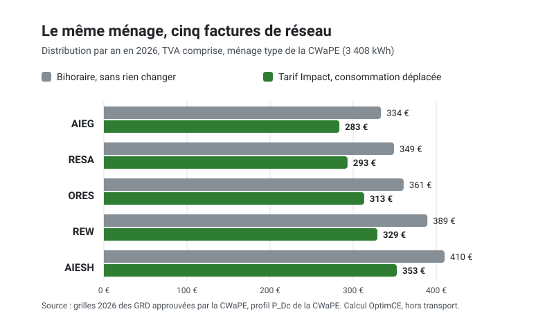

En 2026, le tarif de distribution d'électricité en Wallonie dépend d'une chose que vous ne choisissez pas : votre gestionnaire de réseau de distribution (GRD). Pour 3 500 kWh par an au compteur simple, la distribution coûte **400 €** TVA comprise à l'AIEG, 414 € chez RESA, 433 € chez ORES, 463 € au REW et **495 €** à l'AIESH. Même consommation, même compteur : 95 € d'écart, près d'un quart.

Ce guide refait le calcul pour les profils de consommation de référence de la CWaPE, en bihoraire et au tarif Impact, avec et sans voiture électrique ou pompe à chaleur. Il explique d'où viennent les écarts, puis ce que vous pouvez faire à la place de changer de GRD, ce qui est impossible. Pour savoir quelle ligne des tableaux vous concerne, la [liste des GRD par commune](/outils/quel-est-mon-grd/communes/) donne le gestionnaire de chacune des 261 communes wallonnes.

Il ne refait pas ce qui est écrit ailleurs sur ce site. Le poids du réseau dans la facture et son évolution sont dans [« Facture d'électricité : pourquoi elle reste élevée »](/guides/pourquoi-facture-electricite-reste-elevee-belgique/), les dix leviers pour la réduire, chiffrés sur la grille d'ORES, dans [« Réduire sa facture d'électricité : Wallonie 2026 »](/guides/reduire-facture-electricite-wallonie/), le choix entre tarif social, bihoraire et contrat dynamique dans [« Quel tarif d'électricité choisir en Belgique ? »](/guides/quel-tarif-electricite-choisir-belgique/). Le rôle du GRD face au fournisseur a son guide, [« Différence GRD et fournisseur : qui fait quoi ? »](/guides/difference-grd-fournisseur-elia/), et le tarif Impact le sien, [« Tarif Impact et communauté d'énergie »](/guides/tarif-impact-communaute-energie/).

**Les règles et les montants décrits sont wallons.** Bruxelles et la Flandre sont résumées à la fin.

## Ce que couvre le tarif de distribution, et ce qu'il ne couvre pas

Le tarif de distribution paie le réseau de distribution, en moyenne et en basse tension, jusqu'à votre compteur. Chaque GRD le propose, la CWaPE l'approuve, et votre fournisseur vous le refacture tel quel. La grille de chaque gestionnaire se compose de quatre blocs :

- **l'utilisation du réseau** : une part fixe par an, de 14,10 € à 26,50 € TVA comprise selon le GRD, et un montant par kilowattheure qui dépend de votre formule (simple, bihoraire, exclusif de nuit ou tarif Impact) ;
- **les obligations de service public**, facturées au kilowattheure ;
- **les surcharges** : redevance de voirie, impôt sur les sociétés et autres impôts locaux, provinciaux ou régionaux ;
- **les soldes régulatoires** : les écarts des années passées entre les coûts et recettes budgétés et les montants réels, que la CWaPE contrôle avant de les reporter, à la hausse ou à la baisse, sur les tarifs suivants.

Le tarif Impact n'a pas de part fixe. Sa composante liée à la puissance est à 0 €/kW dans les cinq grilles 2026. L'exclusif de nuit est facturé au même prix que les heures creuses chez les cinq gestionnaires.

**Le transport ne crée aucun écart.** Le GRD refacture aussi les coûts du réseau de transport d'Elia, au même tarif dans toute la Wallonie : 2,74252 c€/kWh TVA comprise en 2026, soit 96 € pour 3 500 kWh. Il s'ajoute aux montants de ce guide, qui portent sur la distribution seule.

**Ne sont pas couverts** : l'énergie, dont le prix dépend de votre contrat ; la cotisation énergie et l'accise spéciale, fixées par la loi fédérale ; la redevance de raccordement, fixée par la Région. La TVA de 6 % s'applique au tarif de distribution comme au reste de la facture, sauf à la redevance de raccordement.

## Méthode : les profils de la CWaPE et les grilles approuvées

Pour simuler les coûts de distribution de 2026 à 2029, la CWaPE utilise des profils de consommation de référence qui sont des consommations réelles de ménages wallons, anonymisées. Elle les publie avec leur répartition entre plages horaires, dans une version de base et une version où le ménage déplace une partie de sa consommation. Nous les reprenons tels quels, à côté du cas de référence de nos autres guides.

| Profil | Consommation annuelle | Bihoraire, pleines / creuses (kWh) | Tarif Impact, ECO / MEDIUM / PIC (kWh) |
|---|---|---|---|
| Cas de référence du site | 3 500 kWh, compteur simple | — | — |
| P_Db, petit ménage | 2 077 kWh | — | 893 / 527 / 656 |
| P_Dc, ménage type | 3 408 kWh | 1 613 / 1 795 ; déplacé : 1 427 / 1 981 | 1 410 / 1 022 / 976 ; déplacé : 1 796 / 790 / 822 |
| P_DcVE1, voiture électrique | 7 380 kWh | 3 445 / 3 935 ; déplacé : 1 787 / 5 604 | 3 147 / 2 079 / 2 154 ; déplacé : 5 282 / 1 032 / 1 050 |
| P_DcPAC, pompe à chaleur | 7 502 kWh | 3 462 / 4 040 ; déplacé : 2 721 / 4 781 | 3 345 / 2 228 / 1 929 ; déplacé : 4 285 / 1 727 / 1 490 |

*Hypothèses : profils de l'annexe 9 de la décision CD-25f26-CWaPE-1119 du 26 juin 2025, colonnes 2026-2029. Dans la version déplacée, le ménage décale lave-vaisselle, lave-linge et séchoir, et selon le profil la recharge de la voiture (3,7 kW, environ 22 000 km par an) ou le préchauffage de la pompe à chaleur. Les volumes déplacés du profil voiture électrique totalisent 7 391 kWh en bihoraire et 7 364 kWh au tarif Impact, et non 7 380 kWh : nous les reprenons tels que publiés. Le cas de 3 500 kWh au compteur simple est celui de nos autres guides.*

Les tarifs sont ceux des grilles 2026 de basse tension approuvées par la CWaPE pour chaque GRD. Le coût d'un profil est la part fixe, plus chaque volume multiplié par le prix de sa plage, toutes composantes de distribution comprises, puis la TVA de 6 %. Recalculés ainsi, les prix au kilowattheure retombent à la cinquième décimale sur la synthèse TVA comprise que la CWaPE a publiée le 3 février 2026. Pour l'AIEG, la ligne « autres impôts locaux, provinciaux ou régionaux » porte la mention « V », sans montant : comme la synthèse de la CWaPE, nous ne l'intégrons pas. Les montants sont arrondis à l'euro.

Pour l'AIESH et RESA, nos totaux hors TVA du ménage type en bihoraire, 387 € et 329 €, sont ceux du dossier de presse de la CWaPE du 1er juillet 2025. Pour ORES et l'AIEG, ils sont plus élevés : 340 € contre 325 €, 315 € contre 305 €. Ce dossier reposait sur les informations connues en juin 2025, et la CWaPE y prévenait que les tarifs pouvaient encore évoluer, notamment avec l'affectation des soldes régulatoires. Nous calculons sur les grilles en vigueur, celle d'ORES approuvée le 18 décembre 2025.

### Télécharger les données

Le fichier [distribution-tariffs-wallonia-2026.csv](/assets/data/distribution-tariffs-wallonia-2026.csv) donne les 90 combinaisons du calcul : une ligne par GRD, profil, formule et variante, avec les volumes par plage, la part fixe, la distribution hors TVA et TVA comprise, le transport et le total réseau, et le lien vers la grille utilisée. Il est publié sous licence [CC BY 4.0](https://creativecommons.org/licenses/by/4.0/deed.fr) : vous pouvez le réutiliser en citant « OptimCE, d'après les grilles approuvées par la CWaPE ». Le [script de calcul](https://github.com/OptimCE/website/blob/main/scripts/compare_distribution_tariffs.py) est public : il contient chaque tarif avec sa source, et refuse de produire un résultat si les grilles ne redonnent pas la synthèse de la CWaPE.

## Résultats : ce que coûte la distribution chez chaque GRD

### Au compteur simple : 3 500 kWh

| GRD | Part fixe (€/an) | Distribution (c€/kWh) | Distribution par an | Écart avec le moins cher |
|---|---|---|---|---|
| AIEG | 19,50 | 10,87 | **400 €** | — |
| RESA | 26,50 | 11,06 | **414 €** | +14 € (+3 %) |
| ORES | 14,10 | 11,98 | **433 €** | +33 € (+8 %) |
| REW | 26,44 | 12,48 | **463 €** | +63 € (+16 %) |
| AIESH | 17,93 | 13,64 | **495 €** | +95 € (+24 %) |

*Hypothèses : grilles 2026 approuvées par la CWaPE, montants TVA comprise ; part fixe et prix au kilowattheure de la synthèse de la CWaPE du 3 février 2026. Distribution seule : le transport ajoute 96 € chez les cinq GRD. Les GRD sont classés du moins cher au plus cher, comme dans les tableaux suivants.*

La part fixe ne pèse presque rien : c'est le prix au kilowattheure qui fait l'écart. RESA a la part fixe la plus élevée et reste le deuxième moins cher.

### Le ménage type, en bihoraire et au tarif Impact

Le profil P_Dc est celui que la CWaPE utilise pour illustrer un ménage résidentiel : 3 408 kWh par an, sans eau chaude électrique.

| GRD | Compteur simple | Bihoraire | Bihoraire, consommation déplacée | Tarif Impact | Impact, consommation déplacée |
|---|---|---|---|---|---|
| AIEG | 390 € | 334 € | 323 € | 312 € | 283 € |
| RESA | 404 € | 349 € | 340 € | 321 € | 293 € |
| ORES | 422 € | 361 € | 350 € | 344 € | 313 € |
| REW | 452 € | 389 € | 378 € | 360 € | 329 € |
| AIESH | 483 € | 410 € | 397 € | 389 € | 353 € |

*Hypothèses : distribution par an, TVA comprise, grilles 2026, profil P_Dc de la CWaPE et ses volumes par plage. La colonne « compteur simple » applique le prix monohoraire aux 3 408 kWh. Le tarif Impact n'a pas de part fixe. Hors transport, 93 € pour ce profil chez les cinq GRD.*

Le classement ne bouge pas d'une colonne à l'autre, et l'écart entre l'AIEG et l'AIESH reste de 23 à 25 % sur tous les profils calculés. Le petit ménage P_Db (2 077 kWh, sans possibilité de déplacement) paie de 245 € à 301 € au compteur simple, de 191 € à 239 € au tarif Impact.

### Avec une voiture électrique ou une pompe à chaleur

Quand la consommation double, l'écart en euros double aussi.

| GRD | Voiture électrique, bihoraire | Voiture électrique, Impact déplacé | Pompe à chaleur, bihoraire | Pompe à chaleur, Impact déplacé |
|---|---|---|---|---|
| AIEG | 697 € | 500 € | 706 € | 590 € |
| RESA | 723 € | 526 € | 732 € | 612 € |
| ORES | 762 € | 555 € | 772 € | 652 € |
| REW | 809 € | 588 € | 820 € | 687 € |
| AIESH | 864 € | 617 € | 875 € | 732 € |

*Hypothèses : profils P_DcVE1 (7 380 kWh, recharge à domicile) et P_DcPAC (7 502 kWh, pompe à chaleur air-eau) de la CWaPE ; colonnes « bihoraire » sans rien changer, colonnes « Impact déplacé » avec la consommation déplacée calculée par la CWaPE. Distribution par an, TVA comprise, hors transport.*

Pour la voiture électrique, 167 € séparent l'AIEG de l'AIESH en bihoraire. Mais un ménage de l'AIESH qui passe au tarif Impact et recharge la nuit paie 617 €, moins qu'un ménage de l'AIEG resté en bihoraire sans rien changer (697 €).

### Prosumers sans compteur communicant

Un prosumer dont le compteur n'enregistre pas ses prélèvements réels paie un tarif prosumer, proportionnel à la puissance nette développable de son installation. Il suit le même ordre.

| GRD | Tarif prosumer (€/kWe, HTVA) | Installation de 4 kWc, par an (TVAC) |
|---|---|---|
| AIEG | 76,45 | 324 € |
| RESA | 79,45 | 337 € |
| ORES | 80,98 | 343 € |
| REW | 87,74 | 372 € |
| AIESH | 93,67 | 397 € |

*Hypothèses : grilles 2026, tarif appliqué à la puissance nette développable déclarée au GRD ; installation de 4 kWc, le cas de référence de nos guides solaires. TVA de 6 %.*

### Frais de réseau par commune : quelle ligne vous concerne ?

En Wallonie, chaque commune dépend d'un seul GRD d'électricité ; selon les données de notre outil, aucune n'est partagée entre deux gestionnaires. Sur les 261 communes wallonnes, ORES en dessert 194 et RESA 54. L'AIEG en dessert six (Andenne, Brunehaut, Gesves, Ohey, Rumes et Viroinval), l'AIESH six aussi (Beaumont, Chimay, Couvin, Froidchapelle, Momignies et Sivry-Rance), et le REW une seule, Wavre. Votre commune est dans la [liste des GRD par commune](/outils/quel-est-mon-grd/communes/) ; votre code postal, dans l'outil [« Quel est mon GRD ? »](/outils/quel-est-mon-grd/).

## Pourquoi ces écarts

### Une méthode commune, cinq budgets

La CWaPE fixe la méthode tarifaire et approuve, pour chaque GRD, un revenu autorisé : le budget qu'il peut récupérer par ses tarifs. Le dossier de presse de la CWaPE résume la règle : le niveau des tarifs dépend du revenu autorisé, d'une part, et du volume de consommation sur lequel ce budget est réparti, d'autre part, puis de la manière dont le GRD le répartit entre niveaux de tension. Pour les cinq GRD ensemble, ce revenu atteint 945 millions d'euros en 2026. Les grilles montrent où chaque gestionnaire se distingue.

| GRD | Utilisation du réseau | Obligations de service public | Surcharges | Soldes régulatoires | Total |
|---|---|---|---|---|---|
| AIEG | 8,94 | 0,68 | 0,78 | 0,47 | **10,87** |
| RESA | 8,61 | 1,01 | 0,75 | 0,69 | **11,06** |
| ORES | 9,76 | 0,54 | 0,87 | 0,81 | **11,98** |
| REW | 9,86 | 1,17 | 1,34 | 0,11 | **12,48** |
| AIESH | 11,53 | 1,10 | 1,01 | 0,00 | **13,64** |

*Hypothèses : prix au compteur simple, c€/kWh TVA comprise, grilles 2026. Surcharges : redevance de voirie, impôt sur les sociétés et autres impôts locaux, provinciaux ou régionaux.*

Trois profils se dégagent :

- **l'AIESH** est la plus chère par le réseau lui-même : 11,53 c€ d'utilisation du réseau, contre 8,61 à 9,86 c€ ailleurs, alors qu'elle n'a aucun solde régulatoire à récupérer en 2026 ;
- **le REW** a un prix d'utilisation du réseau proche de celui d'ORES, mais les obligations de service public et les surcharges les plus élevées des cinq, impôt sur les sociétés en tête ;
- **ORES et RESA** portent les soldes régulatoires les plus lourds : 0,81 et 0,69 c€/kWh. Le dossier de presse de la CWaPE en chiffre l'affectation pour 2026 : 26,1 millions d'euros chez ORES, 13,7 chez RESA, 0,3 à l'AIEG, 0,1 au REW et rien à l'AIESH.

### Un réseau long pour peu de clients

La règle de la CWaPE a une conséquence simple : un réseau long à entretenir pour peu de consommation pèse plus lourd sur chaque kilowattheure. Les données de la CWaPE sur les lignes aériennes montrent la différence de terrain.

| GRD | Lignes aériennes basse tension (km) | Lignes aériennes moyenne tension (km) | Communes desservies |
|---|---|---|---|
| AIEG | 513 | 111 | 6 |
| RESA | 5 170 | 684 | 54 |
| ORES | 19 347 | 2 955 | 194 |
| REW | 160 | 0 | 1 |
| AIESH | 781 | 385 | 6 |

*Hypothèses : lignes aériennes à la fin de 2024, tableau 32 de l'avis CD-25k27-CWaPE-0967 sur les plans d'adaptation 2026-2030 ; communes desservies selon les données de l'outil « Quel est mon GRD ? », version 2026.10.0.*

Avec six communes chacune, l'AIESH, au sud du Hainaut et à Couvin, exploite plus de lignes aériennes que l'AIEG : 781 km contre 513 km en basse tension, 385 km contre 111 km en moyenne tension. Le REW, réseau d'une seule ville, n'a plus aucune ligne aérienne en moyenne tension, et reste pourtant quatrième sur cinq. Le terrain n'explique donc pas tout ; la décomposition ci-dessus montre où son tarif se forme.

### Les investissements des prochaines années

Les plans d'adaptation des GRD, que la CWaPE a analysés en novembre 2025, annoncent des trajectoires différentes. ORES prévoit de faire passer ses investissements annuels de 141 € par code EAN sur 2019-2023 à 378 € sur 2026-2030 ; le REW, qui investissait davantage par client que la moyenne, prévoit moins pour 2026-2030. Ces investissements entrent dans le revenu autorisé, donc dans les tarifs des années suivantes.

### Pas de zone tarifaire à l'intérieur d'un GRD

Chaque gestionnaire publie une seule grille pour tout son territoire. ORES applique les mêmes tarifs à ses 194 communes, RESA à ses 54. En Wallonie, deux voisins paient le même tarif de distribution dès qu'ils dépendent du même GRD ; l'écart n'apparaît qu'à la limite entre deux gestionnaires.

## Peut-on y échapper ? Non : ce que vous pouvez faire à la place

En Wallonie, le Gouvernement désigne le GRD sur proposition de la commune et après avis de la CWaPE, pour vingt ans au plus, et une commune ne peut proposer qu'un seul gestionnaire pour l'électricité (décret électricité, article 10). Changer de fournisseur ne change rien au réseau. Votre GRD ne change que si vous déménagez ou si votre commune en change, comme Couvin, passée d'ORES à l'AIESH en 2024.

Ce qui reste entre vos mains :

- **Choisir sa formule.** Pour le ménage type, passer du bihoraire au tarif Impact en déplaçant lessives et vaisselle fait gagner de 48 € (ORES) à 60 € (REW) par an ; avec une voiture électrique rechargée à domicile, de 196 € à 246 €, plus que les 167 € qui séparent alors le GRD le moins cher du plus cher. Les conditions du tarif Impact, dont le compteur communicant, sont dans notre [guide du tarif Impact](/guides/tarif-impact-communaute-energie/), les autres formules dans [« Quel tarif d'électricité choisir en Belgique ? »](/guides/quel-tarif-electricite-choisir-belgique/).
- **Sortir du tarif prosumer forfaitaire**, si vous produisez et bénéficiez encore de la compensation : avec un compteur qui enregistre vos prélèvements réels, vous payez le réseau sur ces prélèvements, et les grilles plafonnent ce montant à celui de vos prélèvements nets augmenté du tarif prosumer. Le détail est dans [« Compteur communicant en Wallonie : le guide »](/guides/compteur-communicant-wallonie/).
- **Vérifier votre droit au tarif social.** Pour les clients protégés, la CREG fixe une composante réseau unique pour toute la Belgique : 11,727 c€/kWh TVA comprise au quatrième trimestre 2026, transport compris, quel que soit le GRD.
- **Consommer moins aux heures chères.** Chaque kilowattheure évité vous épargne, en plus de l'énergie, le prix de réseau de votre plage : de 10,87 à 13,64 c€ TVA comprise au compteur simple, plus 2,74 c€ de transport.

## Ce que cela change pour le partage d'énergie

La CWaPE est explicite : tous les frais de réseau, transport et distribution, sont dus sur l'électricité partagée, et *« il n'existe pas de réduction tarifaire pour le partage au sein d'une communauté d'énergie »*. Un membre de communauté paie donc, sur chaque kilowattheure partagé, le tarif de son GRD dans sa formule. Le gain du partage se joue sur le prix de l'énergie, pas sur le réseau.

La formule compte ici aussi. Au tarif Impact, un kilowattheure consommé entre 11 h et 17 h, quand les panneaux d'une communauté produisent, paie de 7,30 c€ (AIEG) à 8,26 c€ (REW) de réseau, transport compris ; au compteur simple, de 13,61 c€ à 16,38 c€.

La seule réduction concerne le partage au sein d'un même bâtiment : les grilles 2026 y retirent 80 % des termes proportionnels de distribution et de transport sur l'énergie partagée. Elle vaut davantage là où le réseau coûte plus.

| GRD | Réseau d'un kWh en plage ECO (distribution + transport) | Réduction par kWh, compteur simple | Réduction par kWh, plage ECO | Sur 500 kWh partagés (simple) |
|---|---|---|---|---|
| AIEG | 7,30 | 9,22 | 4,17 | 46 € |
| RESA | 7,73 | 8,95 | 4,09 | 45 € |
| ORES | 7,83 | 9,88 | 4,37 | 49 € |
| REW | 8,26 | 9,96 | 4,39 | 50 € |
| AIESH | 8,24 | 11,29 | 4,78 | 56 € |

*Hypothèses : c€/kWh TVA comprise, grilles 2026. La réduction de 80 % porte sur le terme proportionnel d'utilisation du réseau de distribution et sur celui du transport, pas sur les obligations de service public, les surcharges ni les soldes. 500 kWh partagés par an : le cas de référence de nos guides sur le partage.*

Pour aller plus loin, notre guide [« Rejoindre une communauté d'énergie en Wallonie »](/guides/rejoindre-communaute-energie-wallonie/) décrit les démarches.

## Ce qui change au 1er janvier 2027

Les grilles 2027 de l'AIEG, de l'AIESH, de RESA et du REW sont publiées sur le site de la CWaPE. Pour le ménage type en bihoraire, la distribution y passe de 334 € à 340 € à l'AIEG (+2 %), de 349 € à 359 € chez RESA (+3 %), de 389 € à 394 € au REW (+1 %) et de 410 € à 429 € à l'AIESH (+5 %), TVA comprise.

La grille 2027 d'ORES va changer. Le 15 octobre 2026, la CWaPE a approuvé la demande d'ORES de réviser ses revenus autorisés pour 2026 à 2029 (décision CD-26i15-CWaPE-1318) : pour l'électricité en 2027, la révision porte sur 49,9 millions d'euros, 7,45 % du revenu approuvé en 2025. ORES devait introduire le 5 novembre 2026 une proposition tarifaire adaptée sur cette base ; au 17 novembre 2026, aucune nouvelle grille n'est publiée sur le site de la CWaPE. Le tarif de transport 2027 n'est pas encore publié, et les soldes régulatoires peuvent encore faire bouger tous les montants. Nous referons ce calcul sur les grilles 2027 complètes.

## Bruxelles et la Flandre

**À Bruxelles**, Sibelga est le seul gestionnaire de réseau pour les dix-neuf communes, avec une grille unique approuvée par Brugel ; ses tarifs 2026 ont été adaptés par la décision 370 du 18 novembre 2025. Il n'y a donc aucun écart de distribution d'une commune bruxelloise à l'autre.

**En Flandre**, Fluvius gère le réseau, mais les tarifs sont approuvés par le régulateur flamand pour chaque zone de réseau, et la facture comprend un terme lié à la pointe de puissance. Pour un ménage moyen de 3 500 kWh, le régulateur calcule qu'un ménage de la zone la plus chère paie en 2026 19 % de plus pour l'électricité que dans la zone la moins chère, contre 23 % en 2025. Les structures tarifaires diffèrent trop pour comparer euro pour euro avec la Wallonie.

## Ce qu'il faut retenir

1. **À consommation égale, la distribution coûte jusqu'à un quart de plus selon le GRD.** Pour 3 500 kWh au compteur simple : 400 € à l'AIEG, 414 € chez RESA, 433 € chez ORES, 463 € au REW et 495 € à l'AIESH, TVA comprise.
2. **Le classement est le même pour tous les profils.** Petit ménage, ménage type, voiture électrique ou pompe à chaleur : l'écart entre l'AIEG et l'AIESH reste de 23 à 25 %.
3. **Le transport et les plages horaires sont identiques partout.** Seuls les prix des grilles diffèrent, et il n'y a pas de zone tarifaire à l'intérieur d'un GRD.
4. **L'écart vient du budget de chaque GRD et de ce qu'il répartit au kilowattheure** : un réseau rural plus coûteux à l'AIESH, des obligations de service public et des surcharges plus lourdes au REW, des soldes du passé chez ORES et RESA.
5. **Vous ne choisissez pas votre GRD, mais votre formule.** Pour une voiture électrique, le tarif Impact bien utilisé fait gagner davantage que l'écart entre le GRD le moins cher et le plus cher.
6. **Le partage d'énergie paie le réseau comme tout kilowattheure**, sauf dans un même bâtiment ; au tarif Impact, un kilowattheure consommé entre 11 h et 17 h paie près de deux fois moins de réseau qu'au compteur simple.

> ### Quel tarif s'applique chez vous ?
>
> Chaque commune wallonne dépend d'un seul GRD d'électricité. La liste gratuite d'OptimCE donne le gestionnaire de réseau des 565 communes belges, pour l'électricité et le gaz, avec ses sources.
>
> **[Voir le GRD de ma commune →](/outils/quel-est-mon-grd/communes/)**

## FAQ

### Pourquoi l'électricité est-elle plus chère dans ma commune ?

Parce que votre commune dépend d'un seul GRD, et que chacun des cinq a ses tarifs. Pour 3 500 kWh au compteur simple, la distribution va de 400 € à l'AIEG à 495 € à l'AIESH en 2026. L'énergie dépend de votre contrat, le transport est identique partout. La [liste des GRD par commune](/outils/quel-est-mon-grd/communes/) vous dit lequel vous dessert.

### Quel GRD a le tarif de distribution le moins cher en Wallonie ?

L'AIEG, puis RESA, ORES, le REW et l'AIESH, quel que soit le profil. Pour le ménage type de la CWaPE en bihoraire : 334 € à l'AIEG, 410 € à l'AIESH, TVA comprise. Ce classement ne sert pas à choisir : le GRD est désigné pour votre commune.

### Comment savoir quel tarif de distribution s'applique chez moi ?

Il faut votre GRD et votre formule de comptage. Notre liste par commune donne le GRD des 261 communes wallonnes, et chaque GRD applique une seule grille à tout son territoire.

### Peut-on changer de gestionnaire de réseau pour payer moins ?

Non : la commune propose un seul GRD, désigné pour vingt ans au plus, et changer de fournisseur n'y change rien. Votre levier est la formule : pour le ménage type, le tarif Impact bien utilisé fait gagner 48 à 60 € par an, 196 à 246 € avec une voiture électrique.

### Le tarif Impact est-il moins cher chez ORES, RESA et les autres GRD ?

Les plages sont les mêmes partout, les prix non. En plage ECO, toutes composantes de distribution comprises et TVA incluse : 4,56 c€ à l'AIEG, 4,99 c€ chez RESA, 5,09 c€ chez ORES, 5,50 c€ à l'AIESH et 5,52 c€ au REW. Pour le ménage type qui déplace sa consommation : 293 € chez RESA, 313 € chez ORES.

### Les frais de réseau baissent-ils pour l'électricité partagée en communauté d'énergie ?

Non, sauf dans un même bâtiment, où les grilles retirent 80 % des termes proportionnels. En communauté, le kilowattheure partagé paie le tarif de votre GRD dans votre formule ; le tarif Impact le rend moins cher entre 11 h et 17 h.

## Sources

- [CWaPE — Tarifs de distribution électricité applicables en Région wallonne du 1er janvier au 31 décembre 2026, TVA comprise](https://www.cwape.be/sites/default/files/cwape-documents/SYNTHESE%20DES%20TARIFS%20DE%20DISTRIBUTION%20ELEC%202026%20(FR)-m%C3%A0j%203.02.2026.pdf) — synthèse mise à jour le 3 février 2026 : part fixe et prix au kilowattheure TVA comprise des cinq GRD (simple, bihoraire, Impact, exclusif de nuit), transport à 2,74252 c€/kWh, TVA de 6 %, absence de part fixe au tarif Impact, champ fédéral et régional des surcharges. Consultée le 17 novembre 2026.
- CWaPE — Tarifs périodiques de prélèvement basse tension 2026 de l'[AIEG](https://www.cwape.be/sites/default/files/cwape-documents/AIEG%20-%20Tarifs%20p%C3%A9riodiques%20de%20pr%C3%A9l%C3%A8vement%202026_1.pdf), de l'[AIESH](https://www.cwape.be/sites/default/files/cwape-documents/AIESH%20-%20Tarifs%20p%C3%A9riodiques%20de%20pr%C3%A9l%C3%A8vement%202026.pdf), d'[ORES](https://www.cwape.be/sites/default/files/cwape-documents/ORES%20-%20Tarifs%20p%C3%A9riodiques%20de%20pr%C3%A9l%C3%A8vement%202026_0.pdf) (approuvée le 18 décembre 2025), de [RESA](https://www.cwape.be/sites/default/files/cwape-documents/RESA%20-%20Tarifs%20p%C3%A9riodiques%20de%20pr%C3%A9l%C3%A8vement%202026.pdf) et du [REW](https://www.cwape.be/sites/default/files/cwape-documents/REW%20-%20Tarifs%20p%C3%A9riodiques%20de%20pr%C3%A9l%C3%A8vement%202026.pdf) — composantes hors TVA (utilisation du réseau, obligations de service public, surcharges, soldes régulatoires), part fixe, tarif prosumer, plages horaires du bihoraire et du tarif Impact, composante de puissance à 0 €/kW pour 2026-2029, exclusif de nuit au prix des heures creuses, réduction de 80 % dans un même bâtiment, mention « V » de l'AIEG. Consultés le 17 novembre 2026.
- [CWaPE — Décision CD-26c26-CWaPE-1247 du 26 mars 2026](https://www.cwape.be/sites/default/files/cwape-documents/2026.03.26-1147-AIEG-%20D%C3%A9cision%20r%C3%A9vision%20TP%20distrib%20%C3%A9lec%202026%20suite%20rectification%20erreur%20mat%C3%A9rielle%20%2B%20annexe.pdf) — révision de la grille 2026 de l'AIEG, limitée aux termes de pointe des clients de plus de 56 kVA ; les tarifs résidentiels sont inchangés. Consultée le 17 novembre 2026.
- [CWaPE — Tarifs de refacturation des charges d'utilisation du réseau de transport 2026, tous les GRD de Wallonie](https://www.cwape.be/sites/default/files/cwape-documents/GRD%27s-Tarifs%20de%20refacturation%20du%20transport%202026.pdf) — tarif de transport identique pour les cinq GRD, réduction de 80 % des termes proportionnels dans un même bâtiment. Consulté le 17 novembre 2026.
- [CWaPE — Explication des profils-type de consommation utilisés pour simuler les coûts de distribution basse tension](https://www.cwape.be/sites/default/files/cwape-documents/2025.06.26-GRD%27s-%20Tarifs%20distrib.%20%C3%A9lec.%202026-2029-Annexe%209%20-%20Profils%20conso%20BT-annexe%20IX.pdf) — annexe 9 de la décision CD-25f26-CWaPE-1119 du 26 juin 2025 : profils P_Db, P_Dc, P_DcVE1 et P_DcPAC, volumes par plage, versions de base et déplacées. Consultée le 17 novembre 2026.
- [CWaPE — Dossier de presse, approbation des tarifs périodiques de distribution d'électricité 2026-2029](https://www.cwape.be/sites/default/files/cwape-documents/DP_tarifs%20distribution%202026-2029-final-corrig%C3%A9.pdf) — 1er juillet 2025 : règle de formation des tarifs (revenu autorisé et volumes), soldes régulatoires et leur affectation par GRD, revenu autorisé de 945 millions d'euros en 2026, coûts du profil P_Dc hors TVA. Consulté le 17 novembre 2026.
- [CWaPE — Avis CD-25k27-CWaPE-0967 concernant les plans d'adaptation 2026-2030 des GRD d'électricité](https://www.cwape.be/sites/default/files/cwape-documents/CD-25k27-CWaPE-0967-Avis%20plans%20d'adaptation%20GRD%20%C3%A9lectricit%C3%A9%202026-2030.pdf) — tableau 32 (lignes aériennes par GRD à la fin de 2024), investissements annuels par code EAN, transfert du réseau de Couvin d'ORES à l'AIESH en 2024. Consulté le 17 novembre 2026.
- [CWaPE — Décision CD-26i15-CWaPE-1318 du 15 octobre 2026 relative à la demande de révision des revenus autorisés électricité et gaz 2026 à 2029 d'ORES Assets](https://www.cwape.be/sites/default/files/cwape-documents/2026.10.15-1318-D%C3%A9cision%20sur%20revenus%20autoris%C3%A9s%20%C3%A9lectricit%C3%A9%20et%20gaz%202026-2029%20d'ORES%20-%20version%20anonymis%C3%A9e.pdf) — tableau 29 (49,9 millions d'euros en 2027, 7,45 % du revenu autorisé électricité approuvé le 3 avril 2025), approbation de la demande sous condition résolutoire, et section 7 (proposition tarifaire adaptée au 5 novembre 2026). Consultée le 17 novembre 2026.
- CWaPE — Tarifs périodiques de prélèvement basse tension 2027 de l'[AIEG](https://www.cwape.be/sites/default/files/cwape-documents/AIEG%20-%20Tarifs%20p%C3%A9riodiques%20de%20pr%C3%A9l%C3%A8vement%202027_1.pdf), de l'[AIESH](https://www.cwape.be/sites/default/files/cwape-documents/AIESH%20-%20Tarifs%20p%C3%A9riodiques%20de%20pr%C3%A9l%C3%A8vement%202027_0.pdf), de [RESA](https://www.cwape.be/sites/default/files/cwape-documents/RESA%20-%20Tarifs%20p%C3%A9riodiques%20de%20pr%C3%A9l%C3%A8vement%202027_0.pdf) et du [REW](https://www.cwape.be/sites/default/files/cwape-documents/REW%20-%20Tarifs%20p%C3%A9riodiques%20de%20pr%C3%A9l%C3%A8vement%202027.pdf) — grilles publiées au 17 novembre 2026. Consultés le 17 novembre 2026.
- [CWaPE — Faut-il payer les frais de réseau en cas de partage d'énergie ?](https://www.cwape.be/node/6062) — mise à jour du 23 avril 2026 : frais de réseau dus sur l'électricité partagée, réduction de 80 % réservée au même bâtiment, absence de réduction en communauté d'énergie. Consultée le 17 novembre 2026.
- [CREG — Tarifs sociaux électricité, quatrième trimestre 2026](https://www.creg.be/sites/default/files/assets/Tarifs/Social/E-TSS-FR-2026-Q4.pdf) — composante réseau unique de 11,063 c€/kWh hors TVA, 11,727 c€ TVA comprise, transport et distribution additionnés. Consultée le 17 novembre 2026.
- [Wallex — Décret du 12 avril 2001 relatif à l'organisation du marché régional de l'électricité](https://wallex.wallonie.be/eli/loi-decret/2001/04/12/2001027238) — article 10 : désignation du GRD par le Gouvernement sur proposition de la commune et après avis de la CWaPE, un seul gestionnaire d'électricité par commune, terme de vingt ans au plus. Consulté le 17 novembre 2026.
- [OptimCE — GRD par commune en Belgique](/outils/quel-est-mon-grd/communes/) — données de l'outil « Quel est mon GRD ? », version 2026.10.0 : 261 communes wallonnes, nombre de communes par GRD, aucune commune wallonne partagée entre deux GRD d'électricité.
- [Brugel — Décision 370 du 18 novembre 2025 relative à l'adaptation des tarifs de distribution d'électricité et de gaz de Sibelga pour l'année 2026](https://brugel.brussels/publication/document/decisions/2025/fr/DECISION-370-ADAPTATIONS-TARIFAIRES-2026-SIBELGA.pdf). Consultée le 17 novembre 2026.
- [Vlaamse Nutsregulator — Vlaamse Nutsregulator keurt de distributienettarieven voor 2026 goed](https://www.vlaamsenutsregulator.be/nieuws-en-persoverzicht/pers-2025-02) — communiqué mis à jour le 25 novembre 2025 : écart de 19 % entre zones de réseau en 2026 (23 % en 2025), ménage moyen de 3 500 kWh. Consulté le 17 novembre 2026.
