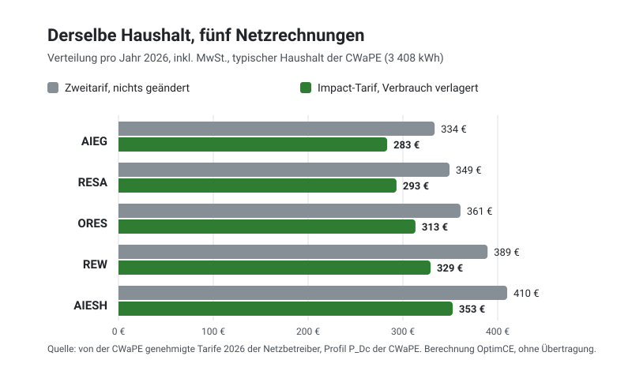

2026 hängt der Verteilungstarif für Strom in der Wallonie von etwas ab, das Sie nicht wählen: Ihrem Verteilernetzbetreiber. Für 3 500 kWh im Jahr mit einem Eintarifzähler kostet die Verteilung einschließlich Mehrwertsteuer **400 €** bei der AIEG, 414 € bei RESA, 433 € bei ORES, 463 € beim REW und **495 €** bei der AIESH. Gleicher Verbrauch, gleicher Zähler: 95 € Unterschied, fast ein Viertel.

Dieser Ratgeber rechnet mit den Referenzprofilen der wallonischen Regulierungsbehörde CWaPE nach, im Zweitarif und im Impact-Tarif, mit und ohne Elektroauto oder Wärmepumpe. Er erklärt, woher die Unterschiede kommen und was Sie tun können, statt den Netzbetreiber zu wechseln, denn das ist nicht möglich. Welche Zeile der Tabellen Sie betrifft, zeigt die [Liste der Netzbetreiber nach Gemeinde](/de/werkzeuge/netzbetreiber-finden/gemeinden/) für jede der 261 wallonischen Gemeinden.

Er wiederholt nicht, was an anderer Stelle auf dieser Website steht. Das Gewicht des Netzes in der Rechnung und seine Entwicklung stehen in [„Warum die Stromrechnung in Belgien hoch bleibt“](/de/ratgeber/warum-stromrechnung-hoch-bleibt-belgien/), zehn Hebel zum Sparen, berechnet mit dem Tarif von ORES, in [„Stromrechnung senken: Wallonien 2026“](/de/ratgeber/stromrechnung-senken-wallonien/), die Wahl zwischen Sozialtarif, Zweitarif und dynamischem Vertrag in [„Welchen Stromtarif in Belgien wählen?“](/de/ratgeber/stromtarif-belgien-waehlen/). Die Rolle des Netzbetreibers neben dem Lieferanten hat ihren eigenen Ratgeber, [„Netzbetreiber und Lieferant: wer macht was?“](/de/ratgeber/netzbetreiber-lieferant-elia-wer-macht-was/), ebenso der Impact-Tarif: [„Impact-Tarif und Energiegemeinschaft“](/de/ratgeber/impact-tarif-energiegemeinschaft/).

**Die beschriebenen Regeln und Beträge sind wallonisch und gelten auch in Ostbelgien**, wo ORES das Stromnetz in allen neun Gemeinden betreibt: Für Sie gilt die Zeile ORES. Brüssel und Flandern werden am Ende zusammengefasst. Die meisten Unterlagen der CWaPE und der Netzbetreiber gibt es nur auf Französisch.

## Was der Verteilungstarif abdeckt und was nicht

Der Verteilungstarif bezahlt das Verteilernetz, Mittel- und Niederspannung, bis zu Ihrem Zähler. Jeder Netzbetreiber schlägt ihn vor, die CWaPE genehmigt ihn, und Ihr Lieferant stellt ihn Ihnen unverändert in Rechnung. Das Tarifblatt jedes Netzbetreibers besteht aus vier Blöcken:

- **die Netznutzung**: ein jährlicher Festbetrag, je nach Netzbetreiber 14,10 € bis 26,50 € einschließlich Mehrwertsteuer, und ein Betrag je Kilowattstunde, der von Ihrer Formel abhängt (Eintarif, Zweitarif, Nachtstromzähler oder Impact-Tarif);
- **die gemeinwirtschaftlichen Verpflichtungen**, je Kilowattstunde berechnet;
- **die Zuschläge**: Straßenbenutzungsgebühr, Körperschaftsteuer und sonstige lokale, provinziale oder regionale Steuern;
- **die Regulierungssalden**: die Abweichungen früherer Jahre zwischen geplanten und tatsächlichen Kosten und Einnahmen, die die CWaPE prüft, bevor sie nach oben oder unten auf die folgenden Tarife übertragen werden.

Der Impact-Tarif hat keinen Festbetrag. Sein leistungsabhängiger Bestandteil liegt in allen fünf Tarifblättern 2026 bei 0 €/kW. Der Nachtstromzähler wird bei allen fünf Netzbetreibern zum Schwachlastpreis abgerechnet.

**Die Übertragung schafft keinen Unterschied.** Der Netzbetreiber gibt auch die Kosten des Übertragungsnetzes von Elia weiter, zum gleichen Tarif in der ganzen Wallonie: 2,74252 c€/kWh einschließlich Mehrwertsteuer im Jahr 2026, also 96 € für 3 500 kWh. Sie kommen zu den Beträgen dieses Ratgebers hinzu, die nur die Verteilung betreffen.

**Nicht enthalten** sind: die Energie, deren Preis von Ihrem Vertrag abhängt; der Energiebeitrag und die Sonderakzise, die das föderale Recht festlegt; die Anschlussgebühr, die die Region festlegt. Die Mehrwertsteuer von 6 % gilt für den Verteilungstarif wie für den Rest der Rechnung, außer für die Anschlussgebühr.

## Methode: die Profile der CWaPE und die genehmigten Tarife

Um die Verteilungskosten für 2026 bis 2029 zu simulieren, verwendet die CWaPE Referenzprofile, die den tatsächlichen, anonymisierten Verbrauch wallonischer Haushalte wiedergeben. Sie veröffentlicht sie mit ihrer Aufteilung auf die Zeitfenster, in einer Grundversion und in einer Version, in der der Haushalt einen Teil seines Verbrauchs verlagert. Wir übernehmen sie unverändert, neben dem Referenzfall unserer anderen Ratgeber.

| Profil | Jahresverbrauch | Zweitarif, Hochlast / Schwachlast (kWh) | Impact-Tarif, ECO / MEDIUM / PIC (kWh) |
|---|---|---|---|
| Referenzfall der Website | 3 500 kWh, Eintarif | — | — |
| P_Db, kleiner Haushalt | 2 077 kWh | — | 893 / 527 / 656 |
| P_Dc, typischer Haushalt | 3 408 kWh | 1 613 / 1 795; verlagert: 1 427 / 1 981 | 1 410 / 1 022 / 976; verlagert: 1 796 / 790 / 822 |
| P_DcVE1, Elektroauto | 7 380 kWh | 3 445 / 3 935; verlagert: 1 787 / 5 604 | 3 147 / 2 079 / 2 154; verlagert: 5 282 / 1 032 / 1 050 |
| P_DcPAC, Wärmepumpe | 7 502 kWh | 3 462 / 4 040; verlagert: 2 721 / 4 781 | 3 345 / 2 228 / 1 929; verlagert: 4 285 / 1 727 / 1 490 |

*Annahmen: Profile aus Anhang 9 der Entscheidung CD-25f26-CWaPE-1119 vom 26. Juni 2025, Spalten 2026-2029. In der verlagerten Version verschiebt der Haushalt Geschirrspüler, Waschmaschine und Trockner, je nach Profil auch das Laden des Autos (3,7 kW, etwa 22 000 km im Jahr) oder das Vorheizen der Wärmepumpe. Die verlagerten Mengen des Elektroauto-Profils ergeben zusammen 7 391 kWh im Zweitarif und 7 364 kWh im Impact-Tarif, nicht 7 380 kWh: Wir übernehmen sie wie veröffentlicht. Der Fall von 3 500 kWh im Eintarif ist der unserer anderen Ratgeber.*

Die Tarife sind die von der CWaPE genehmigten Niederspannungstarife 2026 jedes Netzbetreibers. Die Kosten eines Profils sind der Festbetrag plus jede Menge mal dem Preis ihres Zeitfensters, mit allen Bestandteilen der Verteilung, dann 6 % Mehrwertsteuer. So nachgerechnet, treffen die Preise je Kilowattstunde bis zur fünften Dezimalstelle die Übersicht einschließlich Mehrwertsteuer, die die CWaPE am 3. Februar 2026 veröffentlicht hat. Bei der AIEG trägt die Zeile „sonstige lokale, provinziale oder regionale Steuern“ den Buchstaben „V“ ohne Betrag: Wie die Übersicht der CWaPE berücksichtigen wir sie nicht. Die Beträge sind auf den Euro gerundet.

Für die AIESH und RESA entsprechen unsere Summen ohne Mehrwertsteuer für den typischen Haushalt im Zweitarif, 387 € und 329 €, denen der Pressemappe der CWaPE vom 1. Juli 2025. Für ORES und die AIEG liegen sie höher: 340 € statt 325 €, 315 € statt 305 €. Die Pressemappe beruhte auf dem Kenntnisstand vom Juni 2025, und die CWaPE wies darauf hin, dass sich die Tarife noch ändern konnten, insbesondere bei der Zuweisung der Regulierungssalden. Wir rechnen mit den geltenden Tarifen, bei ORES mit dem am 18. Dezember 2025 genehmigten.

### Die Daten herunterladen

Die Datei [distribution-tariffs-wallonia-2026.csv](/assets/data/distribution-tariffs-wallonia-2026.csv) enthält die 90 Kombinationen der Berechnung: eine Zeile je Netzbetreiber, Profil, Formel und Variante, mit den Mengen je Zeitfenster, dem Festbetrag, der Verteilung ohne und mit Mehrwertsteuer, der Übertragung, den gesamten Netzkosten und einem Link zum verwendeten Tarifblatt. Spaltennamen und Werte sind auf Englisch. Sie steht unter der Lizenz [CC BY 4.0](https://creativecommons.org/licenses/by/4.0/deed.de): Sie dürfen sie weiterverwenden, wenn Sie „OptimCE, nach den von der CWaPE genehmigten Tarifen“ nennen. Das [Berechnungsskript](https://github.com/OptimCE/website/blob/main/scripts/compare_distribution_tariffs.py) ist öffentlich: Es enthält jeden Tarif mit seiner Quelle und liefert kein Ergebnis, wenn die Tarifblätter die Übersicht der CWaPE nicht mehr ergeben.

## Ergebnisse: was die Verteilung bei jedem Netzbetreiber kostet

### Mit Eintarifzähler: 3 500 kWh

| Netzbetreiber | Festbetrag (€/Jahr) | Verteilung (c€/kWh) | Verteilung pro Jahr | Abstand zum günstigsten |
|---|---|---|---|---|
| AIEG | 19,50 | 10,87 | **400 €** | — |
| RESA | 26,50 | 11,06 | **414 €** | +14 € (+3 %) |
| ORES | 14,10 | 11,98 | **433 €** | +33 € (+8 %) |
| REW | 26,44 | 12,48 | **463 €** | +63 € (+16 %) |
| AIESH | 17,93 | 13,64 | **495 €** | +95 € (+24 %) |

*Annahmen: von der CWaPE genehmigte Tarife 2026, Beträge einschließlich Mehrwertsteuer; Festbetrag und Preis je Kilowattstunde aus der Übersicht der CWaPE vom 3. Februar 2026. Nur Verteilung: Die Übertragung kommt bei allen fünf Netzbetreibern mit 96 € hinzu. Die Netzbetreiber sind vom günstigsten zum teuersten geordnet, wie in den folgenden Tabellen.*

Der Festbetrag fällt kaum ins Gewicht: Den Unterschied macht der Preis je Kilowattstunde. RESA hat den höchsten Festbetrag und bleibt der zweitgünstigste.

### Der typische Haushalt, im Zweitarif und im Impact-Tarif

P_Dc ist das Profil, mit dem die CWaPE einen Wohnhaushalt veranschaulicht: 3 408 kWh im Jahr, ohne elektrische Warmwasserbereitung.

| Netzbetreiber | Eintarif | Zweitarif | Zweitarif, Verbrauch verlagert | Impact-Tarif | Impact, Verbrauch verlagert |
|---|---|---|---|---|---|
| AIEG | 390 € | 334 € | 323 € | 312 € | 283 € |
| RESA | 404 € | 349 € | 340 € | 321 € | 293 € |
| ORES | 422 € | 361 € | 350 € | 344 € | 313 € |
| REW | 452 € | 389 € | 378 € | 360 € | 329 € |
| AIESH | 483 € | 410 € | 397 € | 389 € | 353 € |

*Annahmen: Verteilung pro Jahr, einschließlich Mehrwertsteuer, Tarife 2026, Profil P_Dc der CWaPE mit seinen Mengen je Zeitfenster. Die Spalte „Eintarif“ wendet den Eintarifpreis auf alle 3 408 kWh an. Der Impact-Tarif hat keinen Festbetrag. Ohne Übertragung, 93 € für dieses Profil bei allen fünf Netzbetreibern.*

Die Rangfolge ändert sich von Spalte zu Spalte nicht, und der Abstand zwischen der AIEG und der AIESH bleibt bei allen berechneten Profilen zwischen 23 und 25 %. Der kleine Haushalt P_Db (2 077 kWh, ohne Verlagerungsmöglichkeit) zahlt im Eintarif 245 € bis 301 €, im Impact-Tarif 191 € bis 239 €.

### Mit Elektroauto oder Wärmepumpe

Wenn sich der Verbrauch verdoppelt, verdoppelt sich auch der Abstand in Euro.

| Netzbetreiber | Elektroauto, Zweitarif | Elektroauto, Impact verlagert | Wärmepumpe, Zweitarif | Wärmepumpe, Impact verlagert |
|---|---|---|---|---|
| AIEG | 697 € | 500 € | 706 € | 590 € |
| RESA | 723 € | 526 € | 732 € | 612 € |
| ORES | 762 € | 555 € | 772 € | 652 € |
| REW | 809 € | 588 € | 820 € | 687 € |
| AIESH | 864 € | 617 € | 875 € | 732 € |

*Annahmen: Profile P_DcVE1 (7 380 kWh, Laden zu Hause) und P_DcPAC (7 502 kWh, Luft-Wasser-Wärmepumpe) der CWaPE; Spalten „Zweitarif“ ohne Änderung, Spalten „Impact verlagert“ mit der von der CWaPE berechneten Verlagerung. Verteilung pro Jahr, einschließlich Mehrwertsteuer, ohne Übertragung.*

Beim Elektroauto liegen im Zweitarif 167 € zwischen der AIEG und der AIESH. Ein Haushalt der AIESH, der zum Impact-Tarif wechselt und nachts lädt, zahlt aber 617 €, weniger als ein Haushalt der AIEG, der im Zweitarif bleibt und nichts ändert (697 €).

### Prosumer ohne Smart Meter

Ein Prosumer, dessen Zähler die tatsächliche Entnahme nicht erfasst, zahlt einen Prosumer-Tarif je Kilowatt netto verfügbare Leistung der Anlage. Er folgt derselben Reihenfolge.

| Netzbetreiber | Prosumer-Tarif (€/kWe, ohne MwSt.) | Anlage mit 4 kWp, pro Jahr (inkl. MwSt.) |
|---|---|---|
| AIEG | 76,45 | 324 € |
| RESA | 79,45 | 337 € |
| ORES | 80,98 | 343 € |
| REW | 87,74 | 372 € |
| AIESH | 93,67 | 397 € |

*Annahmen: Tarife 2026, angewandt auf die dem Netzbetreiber gemeldete netto verfügbare Leistung; Anlage mit 4 kWp, der Referenzfall unserer Solar-Ratgeber. Mehrwertsteuer von 6 %.*

### Netzkosten nach Gemeinde: welche Zeile betrifft Sie?

In der Wallonie wird jede Gemeinde von einem einzigen Stromnetzbetreiber versorgt; nach den Daten unseres Werkzeugs ist keine zwischen zwei Betreibern aufgeteilt. Von den 261 wallonischen Gemeinden versorgt ORES 194 und RESA 54. Die AIEG versorgt sechs (Andenne, Brunehaut, Gesves, Ohey, Rumes und Viroinval), die AIESH ebenfalls sechs (Beaumont, Chimay, Couvin, Froidchapelle, Momignies und Sivry-Rance) und der REW eine einzige, Wavre. Die neun Gemeinden Ostbelgiens gehören alle zu ORES. Ihre Gemeinde finden Sie in der [Liste der Netzbetreiber nach Gemeinde](/de/werkzeuge/netzbetreiber-finden/gemeinden/), Ihre Postleitzahl im Werkzeug [„Netzbetreiber finden“](/de/werkzeuge/netzbetreiber-finden/).

## Woher die Unterschiede kommen

### Eine Methode, fünf Budgets

Die CWaPE legt die Tarifmethode fest und genehmigt für jeden Netzbetreiber ein zulässiges Einkommen: das Budget, das er über seine Tarife hereinholen darf. Die Pressemappe der CWaPE fasst die Regel zusammen: Die Höhe der Tarife hängt vom zulässigen Einkommen einerseits und von der Verbrauchsmenge ab, auf die dieses Budget verteilt wird, andererseits, dann davon, wie der Netzbetreiber es auf die Spannungsebenen aufteilt. Für die fünf Netzbetreiber zusammen erreicht dieses Einkommen 2026 945 Millionen Euro. Die Tarifblätter zeigen, wo sich jeder Netzbetreiber abhebt.

| Netzbetreiber | Netznutzung | Gemeinwirtschaftliche Verpflichtungen | Zuschläge | Regulierungssalden | Gesamt |
|---|---|---|---|---|---|
| AIEG | 8,94 | 0,68 | 0,78 | 0,47 | **10,87** |
| RESA | 8,61 | 1,01 | 0,75 | 0,69 | **11,06** |
| ORES | 9,76 | 0,54 | 0,87 | 0,81 | **11,98** |
| REW | 9,86 | 1,17 | 1,34 | 0,11 | **12,48** |
| AIESH | 11,53 | 1,10 | 1,01 | 0,00 | **13,64** |

*Annahmen: Eintarifpreis, c€/kWh einschließlich Mehrwertsteuer, Tarife 2026. Zuschläge: Straßenbenutzungsgebühr, Körperschaftsteuer und sonstige lokale, provinziale oder regionale Steuern.*

Drei Muster fallen auf:

- **die AIESH** ist wegen des Netzes selbst am teuersten: 11,53 c€ für die Netznutzung, gegenüber 8,61 bis 9,86 c€ bei den anderen, obwohl sie 2026 keinen Regulierungssaldo zurückholt;
- **der REW** hat einen Preis für die Netznutzung nahe dem von ORES, aber die höchsten gemeinwirtschaftlichen Verpflichtungen und Zuschläge der fünf, allen voran die Körperschaftsteuer;
- **ORES und RESA** tragen die schwersten Regulierungssalden: 0,81 und 0,69 c€/kWh. Die Pressemappe der CWaPE beziffert die Zuweisung für 2026 auf 26,1 Millionen Euro bei ORES, 13,7 Millionen bei RESA, 0,3 Millionen bei der AIEG, 0,1 Millionen beim REW und nichts bei der AIESH.

### Ein langes Netz für wenige Kunden

Die Regel der CWaPE hat eine einfache Folge: Ein Netz, das lang zu unterhalten ist und wenig Verbrauch hat, lastet schwerer auf jeder Kilowattstunde. Die Daten der CWaPE zu den Freileitungen zeigen den Unterschied im Gelände.

| Netzbetreiber | Niederspannungs-Freileitungen (km) | Mittelspannungs-Freileitungen (km) | Versorgte Gemeinden |
|---|---|---|---|
| AIEG | 513 | 111 | 6 |
| RESA | 5 170 | 684 | 54 |
| ORES | 19 347 | 2 955 | 194 |
| REW | 160 | 0 | 1 |
| AIESH | 781 | 385 | 6 |

*Annahmen: Freileitungen Ende 2024, Tabelle 32 der Stellungnahme CD-25k27-CWaPE-0967 zu den Anpassungsplänen 2026-2030; versorgte Gemeinden nach den Daten des Werkzeugs „Netzbetreiber finden“, Version 2026.10.0.*

Mit je sechs Gemeinden betreibt die AIESH, im Süden des Hennegaus und in Couvin, mehr Freileitungen als die AIEG: 781 km gegenüber 513 km in der Niederspannung, 385 km gegenüber 111 km in der Mittelspannung. Der REW, das Netz einer einzigen Stadt, hat keine Mittelspannungs-Freileitung mehr und ist trotzdem Vierter von fünf. Das Gelände erklärt also nicht alles; die Aufschlüsselung oben zeigt, wo sein Tarif entsteht.

### Die Investitionen der nächsten Jahre

Die Anpassungspläne der Netzbetreiber, die die CWaPE im November 2025 geprüft hat, kündigen unterschiedliche Wege an. ORES will seine jährlichen Investitionen von 141 € je EAN-Code im Zeitraum 2019-2023 auf 378 € im Zeitraum 2026-2030 steigern; der REW, der bisher mehr je Kunde investierte als der Durchschnitt, plant für 2026-2030 weniger. Diese Investitionen fließen in das zulässige Einkommen und damit in die Tarife der folgenden Jahre.

### Keine Tarifzonen innerhalb eines Netzbetreibers

Jeder Netzbetreiber veröffentlicht ein einziges Tarifblatt für sein ganzes Gebiet. ORES wendet in seinen 194 Gemeinden dieselben Tarife an, RESA in seinen 54. In der Wallonie zahlen zwei Nachbarn denselben Verteilungstarif, sobald sie vom selben Netzbetreiber abhängen; der Unterschied zeigt sich erst an der Grenze zwischen zwei Betreibern.

## Lässt sich das umgehen? Nein: was Sie stattdessen tun können

In der Wallonie bestimmt die Regierung den Netzbetreiber auf Vorschlag der Gemeinde und nach Stellungnahme der CWaPE, für höchstens zwanzig Jahre, und eine Gemeinde darf für Strom nur einen einzigen Betreiber vorschlagen (wallonisches Elektrizitätsdekret, Artikel 10). Ein Lieferantenwechsel ändert am Netz nichts. Ihr Netzbetreiber ändert sich nur, wenn Sie umziehen oder Ihre Gemeinde den Betreiber wechselt, wie Couvin, das 2024 von ORES zur AIESH übergegangen ist.

Was in Ihrer Hand bleibt:

- **Die Formel wählen.** Für den typischen Haushalt bringt der Wechsel vom Zweitarif zum Impact-Tarif mit verlagertem Waschen und Spülen 48 € (ORES) bis 60 € (REW) im Jahr; mit einem zu Hause geladenen Elektroauto 196 € bis 246 €, mehr als die 167 €, die dann den günstigsten vom teuersten Netzbetreiber trennen. Die Bedingungen des Impact-Tarifs, darunter der Smart Meter, stehen in unserem [Ratgeber zum Impact-Tarif](/de/ratgeber/impact-tarif-energiegemeinschaft/), die anderen Formeln in [„Welchen Stromtarif in Belgien wählen?“](/de/ratgeber/stromtarif-belgien-waehlen/).
- **Den pauschalen Prosumer-Tarif verlassen**, wenn Sie Strom erzeugen und noch von der Kompensation profitieren: Mit einem Zähler, der Ihre tatsächliche Entnahme erfasst, zahlen Sie das Netz auf diese Entnahme, und die Tarifblätter begrenzen den Betrag auf die Kosten Ihrer Nettoentnahme plus Prosumer-Tarif. Die Einzelheiten stehen in [„Smart Meter in der Wallonie: der Ratgeber“](/de/ratgeber/smart-meter-wallonie/).
- **Ihren Anspruch auf den Sozialtarif prüfen.** Für geschützte Kunden legt die föderale Regulierungsbehörde CREG einen einheitlichen Netzanteil für ganz Belgien fest: 11,727 c€/kWh einschließlich Mehrwertsteuer im vierten Quartal 2026, Übertragung inbegriffen, unabhängig vom Netzbetreiber.
- **In den teuren Stunden weniger verbrauchen.** Jede eingesparte Kilowattstunde erspart Ihnen neben der Energie den Netzpreis ihres Zeitfensters: 10,87 bis 13,64 c€ einschließlich Mehrwertsteuer im Eintarif, dazu 2,74 c€ Übertragung.

## Was das für das Teilen von Strom bedeutet

Die CWaPE ist eindeutig: Alle Netzkosten, Übertragung und Verteilung, sind auf geteilten Strom geschuldet, und *„für das Teilen innerhalb einer Energiegemeinschaft gibt es keine Tarifermäßigung“* (unsere Übersetzung). Ein Mitglied einer Gemeinschaft zahlt also auf jede geteilte Kilowattstunde den Tarif seines Netzbetreibers in seiner Formel. Der Vorteil des Teilens liegt beim Energiepreis, nicht beim Netz.

Auch hier zählt die Formel. Im Impact-Tarif zahlt eine Kilowattstunde, die zwischen 11 und 17 Uhr verbraucht wird, wenn die Solaranlagen einer Gemeinschaft erzeugen, 7,30 c€ (AIEG) bis 8,26 c€ (REW) für das Netz, Übertragung inbegriffen; im Eintarif 13,61 c€ bis 16,38 c€.

Die einzige Ermäßigung betrifft das Teilen innerhalb desselben Gebäudes: Die Tarife 2026 ziehen dort 80 % der verbrauchsabhängigen Bestandteile von Verteilung und Übertragung auf den geteilten Strom ab. Sie ist dort mehr wert, wo das Netz mehr kostet.

| Netzbetreiber | Netzkosten einer kWh im ECO-Fenster (Verteilung + Übertragung) | Ermäßigung pro kWh, Eintarif | Ermäßigung pro kWh, ECO-Fenster | Bei 500 kWh geteiltem Strom (Eintarif) |
|---|---|---|---|---|
| AIEG | 7,30 | 9,22 | 4,17 | 46 € |
| RESA | 7,73 | 8,95 | 4,09 | 45 € |
| ORES | 7,83 | 9,88 | 4,37 | 49 € |
| REW | 8,26 | 9,96 | 4,39 | 50 € |
| AIESH | 8,24 | 11,29 | 4,78 | 56 € |

*Annahmen: c€/kWh einschließlich Mehrwertsteuer, Tarife 2026. Die Ermäßigung von 80 % gilt für den verbrauchsabhängigen Netznutzungsbestandteil der Verteilung und für den der Übertragung, nicht für gemeinwirtschaftliche Verpflichtungen, Zuschläge oder Salden. 500 kWh geteilter Strom im Jahr: der Referenzfall unserer Ratgeber zum Teilen.*

Wie Sie weitergehen, beschreibt unser Ratgeber [„Energiegemeinschaft in der Wallonie beitreten“](/de/ratgeber/energiegemeinschaft-beitreten-wallonien/).

## Was sich am 1. Januar 2027 ändert

Die Tarifblätter 2027 der AIEG, der AIESH, von RESA und des REW sind auf der Website der CWaPE veröffentlicht. Für den typischen Haushalt im Zweitarif steigt die Verteilung von 334 € auf 340 € bei der AIEG (+2 %), von 349 € auf 359 € bei RESA (+3 %), von 389 € auf 394 € beim REW (+1 %) und von 410 € auf 429 € bei der AIESH (+5 %), einschließlich Mehrwertsteuer.

Das Tarifblatt 2027 von ORES wird sich ändern. Am 15. Oktober 2026 hat die CWaPE den Antrag von ORES genehmigt, sein zulässiges Einkommen für 2026 bis 2029 zu überarbeiten (Entscheidung CD-26i15-CWaPE-1318): Für Strom im Jahr 2027 geht es um 49,9 Millionen Euro, 7,45 % des 2025 genehmigten Einkommens. ORES sollte am 5. November 2026 auf dieser Grundlage einen angepassten Tarifvorschlag einreichen; am 17. November 2026 ist auf der Website der CWaPE noch kein neues Tarifblatt veröffentlicht. Auch der Übertragungstarif 2027 ist noch nicht veröffentlicht, und die Regulierungssalden können noch alle Beträge verschieben. Wir rechnen neu, sobald die Tarife 2027 vollständig sind.

## Brüssel und Flandern

**In Brüssel** ist Sibelga der einzige Netzbetreiber für die neunzehn Gemeinden, mit einem einzigen von der Regulierungsbehörde Brugel genehmigten Tarifblatt; seine Tarife 2026 wurden mit der Entscheidung 370 vom 18. November 2025 angepasst. Von einer Brüsseler Gemeinde zur anderen gibt es daher keinen Unterschied bei der Verteilung.

**In Flandern** betreibt Fluvius das Netz, die Tarife werden aber von der flämischen Regulierungsbehörde für jedes Netzgebiet genehmigt, und die Rechnung enthält einen Bestandteil nach der Spitzenleistung. Für einen durchschnittlichen Haushalt mit 3 500 kWh berechnet die Behörde, dass ein Haushalt im teuersten Netzgebiet 2026 für Strom 19 % mehr zahlt als im günstigsten, gegenüber 23 % im Jahr 2025. Die Tarifstrukturen unterscheiden sich zu stark, um Euro für Euro mit der Wallonie zu vergleichen.

## Das Wichtigste in Kürze

1. **Bei gleichem Verbrauch kostet die Verteilung je nach Netzbetreiber bis zu einem Viertel mehr.** Für 3 500 kWh im Eintarif: 400 € bei der AIEG, 414 € bei RESA, 433 € bei ORES, 463 € beim REW und 495 € bei der AIESH, einschließlich Mehrwertsteuer.
2. **Die Rangfolge ist für jedes Profil dieselbe.** Kleiner Haushalt, typischer Haushalt, Elektroauto oder Wärmepumpe: Der Abstand zwischen der AIEG und der AIESH bleibt bei 23 bis 25 %.
3. **Übertragung und Zeitfenster sind überall gleich.** Nur die Preise der Tarifblätter unterscheiden sich, und innerhalb eines Netzbetreibers gibt es keine Tarifzonen.
4. **Der Unterschied kommt vom Budget jedes Netzbetreibers und dem, was er je Kilowattstunde umlegt**: ein teureres ländliches Netz bei der AIESH, schwerere gemeinwirtschaftliche Verpflichtungen und Zuschläge beim REW, Salden aus der Vergangenheit bei ORES und RESA.
5. **Den Netzbetreiber wählen Sie nicht, die Formel schon.** Mit einem Elektroauto bringt ein gut genutzter Impact-Tarif mehr als der Abstand zwischen dem günstigsten und dem teuersten Netzbetreiber.
6. **Geteilter Strom zahlt das Netz wie jede Kilowattstunde**, außer innerhalb desselben Gebäudes; im Impact-Tarif zahlt eine zwischen 11 und 17 Uhr verbrauchte Kilowattstunde fast nur halb so viel Netz wie im Eintarif.

> ### Welcher Tarif gilt bei Ihnen?
>
> Jede wallonische Gemeinde wird von einem einzigen Stromnetzbetreiber versorgt. Die kostenlose Liste von OptimCE nennt den Netzbetreiber aller 565 belgischen Gemeinden, für Strom und Gas, mit ihren Quellen.
>
> **[Netzbetreiber meiner Gemeinde finden →](/de/werkzeuge/netzbetreiber-finden/gemeinden/)**

## FAQ

### Warum ist Strom in meiner Gemeinde teurer?

Weil Ihre Gemeinde von einem einzigen Netzbetreiber abhängt und jeder der fünf eigene Tarife hat. Für 3 500 kWh im Eintarif reicht die Verteilung 2026 von 400 € bei der AIEG bis 495 € bei der AIESH. Die Energie hängt von Ihrem Vertrag ab, die Übertragung ist überall gleich. In Ostbelgien ist es überall ORES; die [Liste nach Gemeinde](/de/werkzeuge/netzbetreiber-finden/gemeinden/) nennt Ihren Netzbetreiber.

### Welcher Netzbetreiber hat den günstigsten Verteilungstarif in der Wallonie?

Die AIEG, dann RESA, ORES, der REW und die AIESH, unabhängig vom Profil. Für den typischen Haushalt der CWaPE im Zweitarif: 334 € bei der AIEG, 410 € bei der AIESH, einschließlich Mehrwertsteuer. Wählen können Sie ihn nicht: Der Netzbetreiber ist für Ihre Gemeinde bestimmt.

### Wie erfahre ich, welcher Verteilungstarif bei mir gilt?

Sie brauchen Ihren Netzbetreiber und Ihre Zählerformel. Unsere Liste nach Gemeinde nennt den Netzbetreiber der 261 wallonischen Gemeinden, und jeder Netzbetreiber wendet ein einziges Tarifblatt auf sein ganzes Gebiet an.

### Kann ich den Netzbetreiber wechseln, um weniger zu zahlen?

Nein: Die Gemeinde schlägt einen einzigen Netzbetreiber vor, bestimmt für höchstens zwanzig Jahre, und ein Lieferantenwechsel ändert daran nichts. Ihr Hebel ist die Formel: Für den typischen Haushalt bringt ein gut genutzter Impact-Tarif 48 bis 60 € im Jahr, mit Elektroauto 196 bis 246 €.

### Ist der Impact-Tarif bei ORES, RESA oder den anderen Netzbetreibern günstiger?

Die Zeitfenster sind überall gleich, die Preise nicht. Im ECO-Fenster, mit allen Bestandteilen der Verteilung und einschließlich Mehrwertsteuer: 4,56 c€ bei der AIEG, 4,99 c€ bei RESA, 5,09 c€ bei ORES, 5,50 c€ bei der AIESH und 5,52 c€ beim REW. Für den typischen Haushalt, der seinen Verbrauch verlagert: 293 € bei RESA, 313 € bei ORES.

### Sinken die Netzkosten für geteilten Strom in einer Energiegemeinschaft?

Nein, außer innerhalb desselben Gebäudes, wo die Tarifblätter 80 % der verbrauchsabhängigen Bestandteile abziehen. In einer Gemeinschaft zahlt die geteilte Kilowattstunde den Tarif Ihres Netzbetreibers in Ihrer Formel; der Impact-Tarif macht sie zwischen 11 und 17 Uhr günstiger.

## Quellen

- [CWaPE — Tarifs de distribution électricité applicables en Région wallonne du 1er janvier au 31 décembre 2026, TVAC](https://www.cwape.be/sites/default/files/cwape-documents/SYNTHESE%20DES%20TARIFS%20DE%20DISTRIBUTION%20ELEC%202026%20(FR)-m%C3%A0j%203.02.2026.pdf) (auf Französisch; die CWaPE veröffentlicht auch eine deutsche Fassung) — Übersicht, aktualisiert am 3. Februar 2026: Festbetrag und Preis je Kilowattstunde einschließlich Mehrwertsteuer der fünf Netzbetreiber (Eintarif, Zweitarif, Impact, Nachtstrom), Übertragung zu 2,74252 c€/kWh, Mehrwertsteuer von 6 %, kein Festbetrag im Impact-Tarif, föderale und regionale Zuständigkeit für die Abgaben. Abgerufen am 17. November 2026.
- CWaPE — Periodische Entnahmetarife Niederspannung 2026 der [AIEG](https://www.cwape.be/sites/default/files/cwape-documents/AIEG%20-%20Tarifs%20p%C3%A9riodiques%20de%20pr%C3%A9l%C3%A8vement%202026_1.pdf), der [AIESH](https://www.cwape.be/sites/default/files/cwape-documents/AIESH%20-%20Tarifs%20p%C3%A9riodiques%20de%20pr%C3%A9l%C3%A8vement%202026.pdf), von [ORES](https://www.cwape.be/sites/default/files/cwape-documents/ORES%20-%20Tarifs%20p%C3%A9riodiques%20de%20pr%C3%A9l%C3%A8vement%202026_0.pdf) (genehmigt am 18. Dezember 2025), von [RESA](https://www.cwape.be/sites/default/files/cwape-documents/RESA%20-%20Tarifs%20p%C3%A9riodiques%20de%20pr%C3%A9l%C3%A8vement%202026.pdf) und des [REW](https://www.cwape.be/sites/default/files/cwape-documents/REW%20-%20Tarifs%20p%C3%A9riodiques%20de%20pr%C3%A9l%C3%A8vement%202026.pdf) (auf Französisch) — Bestandteile ohne Mehrwertsteuer (Netznutzung, gemeinwirtschaftliche Verpflichtungen, Zuschläge, Regulierungssalden), Festbetrag, Prosumer-Tarif, Zeitfenster von Zweitarif und Impact-Tarif, leistungsabhängiger Bestandteil von 0 €/kW für 2026-2029, Nachtstrom zum Schwachlastpreis, Ermäßigung von 80 % im selben Gebäude, „V“ der AIEG. Abgerufen am 17. November 2026.
- [CWaPE — Entscheidung CD-26c26-CWaPE-1247 vom 26. März 2026](https://www.cwape.be/sites/default/files/cwape-documents/2026.03.26-1147-AIEG-%20D%C3%A9cision%20r%C3%A9vision%20TP%20distrib%20%C3%A9lec%202026%20suite%20rectification%20erreur%20mat%C3%A9rielle%20%2B%20annexe.pdf) (auf Französisch) — Überarbeitung des Tarifblatts 2026 der AIEG, beschränkt auf die Spitzenleistungsbestandteile von Kunden über 56 kVA; die Haushaltstarife bleiben unverändert. Abgerufen am 17. November 2026.
- [CWaPE — Tarife 2026 für die Weiterberechnung der Kosten des Übertragungsnetzes, alle wallonischen Netzbetreiber](https://www.cwape.be/sites/default/files/cwape-documents/GRD%27s-Tarifs%20de%20refacturation%20du%20transport%202026.pdf) (auf Französisch) — derselbe Übertragungstarif für die fünf Netzbetreiber, Ermäßigung von 80 % im selben Gebäude. Abgerufen am 17. November 2026.
- [CWaPE — Erläuterung der Musterverbrauchsprofile zur Simulation der Verteilungskosten in der Niederspannung](https://www.cwape.be/sites/default/files/cwape-documents/2025.06.26-GRD%27s-%20Tarifs%20distrib.%20%C3%A9lec.%202026-2029-Annexe%209%20-%20Profils%20conso%20BT-annexe%20IX.pdf) (auf Französisch) — Anhang 9 der Entscheidung CD-25f26-CWaPE-1119 vom 26. Juni 2025: Profile P_Db, P_Dc, P_DcVE1 und P_DcPAC, Mengen je Zeitfenster, Grund- und verlagerte Versionen. Abgerufen am 17. November 2026.
- [CWaPE — Pressemappe zur Genehmigung der periodischen Stromverteilungstarife 2026-2029](https://www.cwape.be/sites/default/files/cwape-documents/DP_tarifs%20distribution%202026-2029-final-corrig%C3%A9.pdf) (auf Französisch) — 1. Juli 2025: Bildung der Tarife (zulässiges Einkommen und Mengen), Regulierungssalden und ihre Zuweisung je Netzbetreiber, zulässiges Einkommen von 945 Millionen Euro im Jahr 2026, Kosten des Profils P_Dc ohne Mehrwertsteuer. Abgerufen am 17. November 2026.
- [CWaPE — Stellungnahme CD-25k27-CWaPE-0967 zu den Anpassungsplänen 2026-2030 der Stromnetzbetreiber](https://www.cwape.be/sites/default/files/cwape-documents/CD-25k27-CWaPE-0967-Avis%20plans%20d'adaptation%20GRD%20%C3%A9lectricit%C3%A9%202026-2030.pdf) (auf Französisch) — Tabelle 32 (Freileitungen je Netzbetreiber Ende 2024), jährliche Investitionen je EAN-Code, Übergang des Netzes von Couvin von ORES zur AIESH im Jahr 2024. Abgerufen am 17. November 2026.
- [CWaPE — Entscheidung CD-26i15-CWaPE-1318 vom 15. Oktober 2026 zum Antrag von ORES Assets auf Überarbeitung des zulässigen Einkommens Strom und Gas 2026-2029](https://www.cwape.be/sites/default/files/cwape-documents/2026.10.15-1318-D%C3%A9cision%20sur%20revenus%20autoris%C3%A9s%20%C3%A9lectricit%C3%A9%20et%20gaz%202026-2029%20d'ORES%20-%20version%20anonymis%C3%A9e.pdf) (auf Französisch) — Tabelle 29 (49,9 Millionen Euro im Jahr 2027, 7,45 % des am 3. April 2025 genehmigten Einkommens Strom), Genehmigung unter auflösender Bedingung und Abschnitt 7 (angepasster Tarifvorschlag zum 5. November 2026). Abgerufen am 17. November 2026.
- CWaPE — Periodische Entnahmetarife Niederspannung 2027 der [AIEG](https://www.cwape.be/sites/default/files/cwape-documents/AIEG%20-%20Tarifs%20p%C3%A9riodiques%20de%20pr%C3%A9l%C3%A8vement%202027_1.pdf), der [AIESH](https://www.cwape.be/sites/default/files/cwape-documents/AIESH%20-%20Tarifs%20p%C3%A9riodiques%20de%20pr%C3%A9l%C3%A8vement%202027_0.pdf), von [RESA](https://www.cwape.be/sites/default/files/cwape-documents/RESA%20-%20Tarifs%20p%C3%A9riodiques%20de%20pr%C3%A9l%C3%A8vement%202027_0.pdf) und des [REW](https://www.cwape.be/sites/default/files/cwape-documents/REW%20-%20Tarifs%20p%C3%A9riodiques%20de%20pr%C3%A9l%C3%A8vement%202027.pdf) (auf Französisch) — am 17. November 2026 veröffentlichte Tarifblätter. Abgerufen am 17. November 2026.
- [CWaPE — Faut-il payer les frais de réseau en cas de partage d'énergie ?](https://www.cwape.be/node/6062) (auf Französisch) — aktualisiert am 23. April 2026: Netzkosten auf geteilten Strom geschuldet, Ermäßigung von 80 % nur im selben Gebäude, keine Ermäßigung in einer Energiegemeinschaft. Abgerufen am 17. November 2026.
- [CREG — Sozialtarife Strom, viertes Quartal 2026](https://www.creg.be/sites/default/files/assets/Tarifs/Social/E-TSS-FR-2026-Q4.pdf) (auf Französisch) — einheitlicher Netzanteil von 11,063 c€/kWh ohne Mehrwertsteuer, 11,727 c€ einschließlich, Übertragung und Verteilung zusammengerechnet. Abgerufen am 17. November 2026.
- [Wallex — Dekret vom 12. April 2001 über die Organisation des regionalen Elektrizitätsmarktes](https://wallex.wallonie.be/eli/loi-decret/2001/04/12/2001027238) (auf Französisch) — Artikel 10: Bestimmung des Netzbetreibers durch die Regierung auf Vorschlag der Gemeinde und nach Stellungnahme der CWaPE, ein einziger Stromnetzbetreiber je Gemeinde, Frist von höchstens zwanzig Jahren. Abgerufen am 17. November 2026.
- [OptimCE — Netzbetreiber nach Gemeinde in Belgien](/de/werkzeuge/netzbetreiber-finden/gemeinden/) — Daten des Werkzeugs „Netzbetreiber finden“, Version 2026.10.0: 261 wallonische Gemeinden, Zahl der Gemeinden je Netzbetreiber, keine wallonische Gemeinde zwischen zwei Stromnetzbetreibern aufgeteilt, ORES in den neun Gemeinden Ostbelgiens.
- [Brugel — Entscheidung 370 vom 18. November 2025 über die Anpassung der Strom- und Gasverteilungstarife von Sibelga für 2026](https://brugel.brussels/publication/document/decisions/2025/fr/DECISION-370-ADAPTATIONS-TARIFAIRES-2026-SIBELGA.pdf) (auf Französisch). Abgerufen am 17. November 2026.
- [Vlaamse Nutsregulator — Vlaamse Nutsregulator keurt de distributienettarieven voor 2026 goed](https://www.vlaamsenutsregulator.be/nieuws-en-persoverzicht/pers-2025-02) (auf Niederländisch) — Pressemitteilung, aktualisiert am 25. November 2025: Abstand von 19 % zwischen Netzgebieten im Jahr 2026 (23 % im Jahr 2025), durchschnittlicher Haushalt mit 3 500 kWh. Abgerufen am 17. November 2026.
